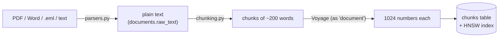
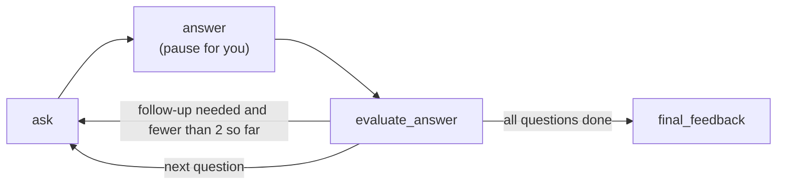
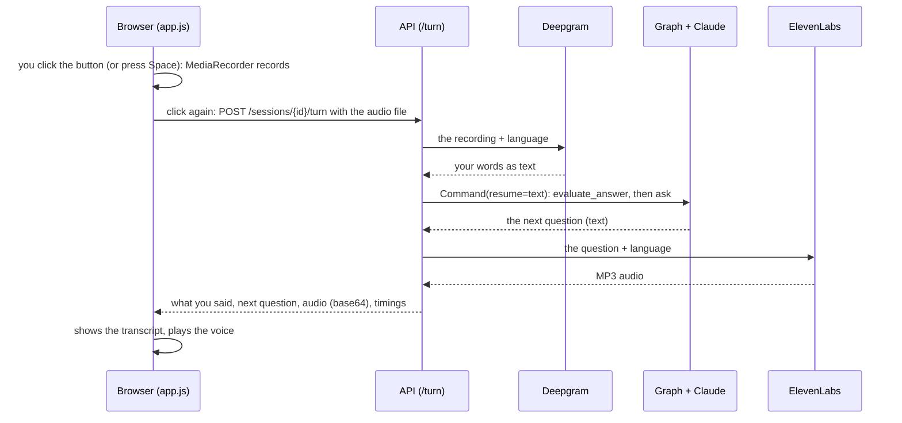
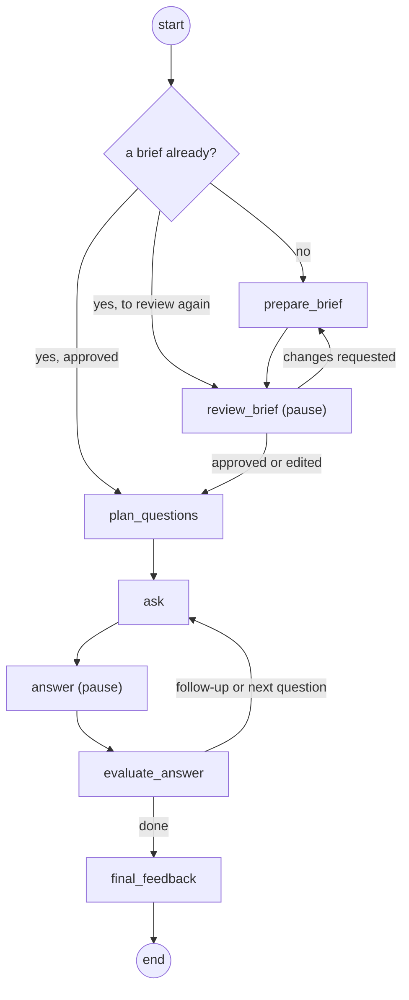

# How it works

A guide to the whole codebase, for beginners and intermediate developers. It explains what each part does, how the parts talk to each other, and why it is built this way. Read it top to bottom once. After that, use the file tour (section 4) and the recipes (section 14) as a reference.

The goals, the phases and the decisions behind them are in [plan.md](plan.md). This file explains the code as it is today.

---

## 1. What the app does

The app runs a **mock job interview**, ending with a **scored feedback report**:

1. You describe an upcoming interview (company, role, interview type, language) and add documents, pasted or as files (PDF, Word, .eml emails): the job post, recruiter emails, call notes, your CV.
2. Claude reads them and writes a short **Interview Brief** (readable in under two minutes): the 3 things to focus on, what the company does, the format and interviewers, what the role needs, the gaps between your CV and the role, and the 5 likely questions.
3. You review the brief and approve it, edit it, or ask for changes.
4. Claude plays the interviewer: it asks questions one at a time, scores each answer and asks follow-ups when an answer is vague. Before each question it searches your documents for the passages that matter, so questions refer to your real CV and the real role.
   There are four interview types: behavioral / HR, tailored to the job post, technical backend, and system design. The two technical ones start from a bank of seeded questions.
5. At the end, Claude writes a feskedback report: scores, strengths, and concrete fixes.

You use it from a web page at http://localhost:8000: you click a button, speak your answer and click again, and the interviewer talks back (Phase 2). The interview can be in English, French or Spanish. You can also type your answers, on the page (switch Voice off) or in a terminal.

---

## 2. The big picture

```mermaid
flowchart LR
  you["You: web page (web/)<br/>or terminal (scripts/interview_cli.py)"] -- HTTP --> api["FastAPI server<br/>app/main.py, app/api/"]
  api -- your recording --> stt["Deepgram<br/>speech-to-text"]
  api -- runs --> graph["Interviewer graph<br/>app/graph/ (LangGraph)"]
  graph -- prompts --> claude["Claude<br/>Sonnet 5.5 and Haiku 5.5"]
  api -- next question --> tts["ElevenLabs<br/>text-to-speech"]
  graph -- saves progress --> db[("Postgres + pgvector<br/>tables, chunks, checkpoints")]
  api -- documents and questions --> voy["Voyage AI<br/>embeddings"]
  api -- reads and writes --> db
  claude -. every call recorded .-> ls["LangSmith<br/>traces"]
```

- The **web page** and the **CLI** contain no interview logic: they send HTTP requests to the server and show the replies.
- For a spoken answer, the server sends your recording to **Deepgram**, which turns it into text. The text goes through the graph exactly like a typed answer, and **ElevenLabs** then turns the next question into speech.
- The **server** (FastAPI) receives each request and runs the **graph** until it needs you again.
- The **graph** is the interviewer. It is a list of steps. Some steps call Claude; others pause and wait for your input.
- **Postgres** stores your interviews and documents, plus the graph's progress (called checkpoints), so you can stop and continue later.
- **Voyage AI** turns each piece of a document, and each search, into an embedding. **pgvector** (inside Postgres) finds the pieces closest to a question.
- **LangSmith** records every Claude call, so you can see exactly what was sent and what came back.

Everything except Claude, Deepgram, ElevenLabs, Voyage AI and LangSmith runs on your machine, in two **Docker** containers: `api` (the server) and `db` (Postgres).

---

## 3. The tools, in plain words

| Tool | What it is | Where it's used |
| --- | --- | --- |
| **Docker / Docker Compose** | Runs programs in isolated "containers", so the app runs the same on every machine. Compose starts several containers together from one file. | [docker-compose.yml](docker-compose.yml), [Dockerfile](Dockerfile) |
| **FastAPI** | A Python framework for building web APIs. You write a function, FastAPI turns it into a URL and checks the incoming JSON. | [app/main.py](app/main.py), [app/api/](app/api/) |
| **Uvicorn** | The web server that runs the FastAPI app. `--reload` restarts it when code changes. | started by docker-compose.yml |
| **Pydantic** | Describes the shape of data with Python classes and validates it ("this field must be text"). | request bodies, Claude's answers ([schemas.py](app/graph/schemas.py)), settings |
| **PostgreSQL** | The database. | the `db` container |
| **pgvector** | A Postgres extension for storing embeddings (lists of numbers that capture what a text means) and finding the closest ones. | [migration 0004](app/db/migrations/versions/0004_chunks_and_question_bank.py), [retrieve.py](app/rag/retrieve.py) |
| **Voyage AI** | Turns a text into an embedding of 1024 numbers (model `voyage-4`). Anthropic has no embedding model and recommends Voyage. | [app/rag/embeddings.py](app/rag/embeddings.py) |
| **pypdf, python-docx** | Read the text out of PDF and Word files. Emails (.eml) are read with Python's own `email` library. | [app/rag/parsers.py](app/rag/parsers.py) |
| **SQLAlchemy** | Lets Python code work with database rows as objects instead of writing SQL. | [app/db/models.py](app/db/models.py) |
| **Alembic** | Creates and changes database tables through numbered "migration" files, and tracks which ones have already run. | [app/db/migrations/](app/db/migrations/) |
| **LangGraph** | A library for building step-by-step AI workflows as a graph. It can save progress (checkpointer) and pause for a human (interrupt). | [app/graph/](app/graph/) |
| **Claude (Anthropic API)** | The AI model. Sonnet 5.5 for careful work (brief, plan, feedback), Haiku 5.5 for fast turns (asking, scoring). | [app/llm.py](app/llm.py) |
| **LangSmith** | A tracing service: records every Claude call and graph step so you can inspect and debug them. | [app/llm.py](app/llm.py) (`wrap_anthropic`) |
| **Deepgram** | Speech-to-text (STT): turns your recorded answer into text. Model `nova-3`, English, French and Spanish. | [app/voice/stt.py](app/voice/stt.py) |
| **ElevenLabs** | Text-to-speech (TTS): turns the interviewer's words into a natural voice. Model `eleven_flash_v2_5`, built for low latency. | [app/voice/tts.py](app/voice/tts.py) |
| **httpx** | A Python HTTP client, used to call Deepgram and ElevenLabs. | app/voice/ |
| **MediaRecorder** | The browser's built-in recorder: it captures the microphone between your clicks on the button. | [web/app.js](web/app.js) |
| **pytest** | Runs the automated tests. | [tests/](tests/) |
| **Caddy** | A web server placed in front of the app in production (a **reverse proxy**: it receives every request from the internet and passes it on to the app). It gets and renews the HTTPS certificate by itself. | [Caddyfile](Caddyfile), [docker-compose.prod.yml](docker-compose.prod.yml) |
| **Amazon SES** (with **boto3**) | AWS's email-sending service, which really delivers the login codes on AWS. boto3 is AWS's Python library. | [app/mail](app/mail/__init__.py) |
| **Terraform** | Describes cloud resources (network, server, permissions...) in text files; `terraform plan` shows what would change and `terraform apply` creates or changes them, so the AWS setup is reviewable and repeatable instead of clicked by hand. | [infra/](infra/) |
| **Cloudflare Turnstile** | A free "are you a person?" check, usually invisible, so bots can't make the server send emails. | [app/auth/turnstile.py](app/auth/turnstile.py), [web/app.js](web/app.js) |

---

## 4. A tour of the files

```
app/
  main.py              The server's entry point: starts the checkpointer, mounts the routes, /health
  config.py            Settings read from .env (models, limits, budgets, database URL)
  llm.py               The only place that calls Claude: structured() and text_reply(); records each call's cost
  costs/               Cost control (Phase 4.5)
    pricing.py         Reads pricing.yaml: what a call used -> dollars
    usage.py           Writes one row per paid call to the usage table, for the right user and session
    budget.py          Adds the rows up: budgets, interviews per day, the spend for GET /usage
  auth/                Accounts (Phase 4.6)
    codes.py           The 6-digit login codes sent by email: make one, check one (stored as an HMAC)
    passwords.py       Admin passwords: hash and check them (Argon2)
    google.py          "Continue with Google": checks Google's ID token (google-auth)
    turnstile.py       Cloudflare Turnstile: checks the page's "you're a person" token before a code is sent
    tokens.py          The random login token in the cookie, and its hash
    deps.py            current_user: who is calling, or 401
    ownership.py       owned_interview / owned_document / owned_session: yours, or 404
    limits.py          Guessing limits: failed logins per email and per IP, registrations per IP (429)
    origin.py          Refuses POST / PATCH / DELETE sent from another website's page (403)
    account.py         Deletes an account and everything it owns, checkpoints included
    routes.py          /auth/config, /auth/start, /auth/verify, /auth/password-login, /auth/google, /auth/logout, /auth/me
  api/
    interviews.py      Interviews, and documents: paste, upload, list the CV, delete
    sessions.py        Start a session, resume it with your reply, retry a failed step; list your latest sessions
    usage.py           GET /usage: what's left (an admin: spend and budgets); POST /access-requests ("Request more"); grant_more
  graph/               The interviewer (LangGraph)
    state.py           What the graph remembers (the "state")
    nodes.py           The 7 steps and the 3 routing functions
    build.py           How the steps are connected
    schemas.py         The shapes Claude must answer in (brief, plan, scores, feedback)
    prompts.py         Loads prompts/*.md and rubrics/*.yaml
    checkpointer.py    Saves the graph's progress in Postgres
  mail/
    __init__.py        Sending email: console (prints it in the logs, local) or Amazon SES (AWS)
  voice/
    __init__.py        SpeechError, and the supported languages (en, fr, es)
    stt.py             Speech-to-text: the interface + Deepgram
    tts.py             Text-to-speech: the interface + ElevenLabs
  rag/                 Searching your documents (retrieval-augmented generation)
    parsers.py         PDF, Word, .eml and text files -> text (and HTML -> text)
    webpage.py         A link -> the page's readable text
    chunking.py        Text -> chunks of a few paragraphs
    embeddings.py      The embedding interface + Voyage AI
    ingest.py          Document -> chunks -> embeddings -> chunks table
    retrieve.py        Question -> closest chunks, or closest question-bank questions
  db/
    models.py          Tables as Python classes: Interview, Document, Chunk, QuestionBankItem, Session, User, LoginSession, EmailCode, AuthAttempt, AccessRequest, Usage, QuestionAudio
    session.py         Database connection, and get_db() for routes
    migrations/        Alembic: env.py, the template, and versions/0001 to 0013
prompts/               Every text sent to Claude, one file per step, plus modes/ (the 4 interview types)
rubrics/               Scoring criteria per interview type (YAML)
question_bank/         Seeded questions for the technical backend and system design types (YAML)
pricing.yaml           What each paid API charges (Claude per token kind, Deepgram, ElevenLabs, Voyage)
scripts/
  interview_cli.py     The terminal interview (the "client"); logs in first
  create_user.py       Creates an account: your own admin account (offers to set its password)
  manage_users.py      Admin: list accounts, disable / enable, delete; requests and grant; admin passwords
  smoke_claude.py      Quick check that the key, models and tracing work
  seed_question_bank.py  Loads question_bank/ into the database and embeds it (runs on every start)
  embed_documents.py   Embeds documents that have no chunks yet
  check-phase0.ps1     Phase 0 check in one command
web/
  index.html           The web page: login, setup (3 steps + My CV), brief, interview, feedback
  app.js               Its logic: login, API calls, click-to-talk recording, audio playback, end / leave
  style.css            Its look: a 7-color palette (listed in CLAUDE.md), two columns on wide screens, light / dark.
                       It borrows the logo's shapes: rounded-square icon tiles, the coral dot after page titles,
                       and the sound bars (on the record button and the floating "working" pill)
  brand/               The Practiss logo: logo-header.png (light) and logo-header-dark.png in the header,
                       app-icon.png on the login card, as the interviewer's avatar in the conversation and
                       as the browser-tab icon; logo-horizontal*.png
                       and logo-stacked.png are the full logos with the tagline, kept for later use
samples/               A fictional job post and CV for testing
my_docs/               Your real CV, job posts and emails (ignored by git: never committed)
tests/                 Tests with a fake Claude, fake speech and a fake embedder, on their own database
evals/audio/           Your recorded answers, when SAVE_AUDIO=true (never committed)
docker-compose.yml     The two containers: api and db (your laptop, with --reload)
docker-compose.prod.yml  Production mode (AWS, or a try on your laptop): caddy, api from its image, db; see 13b
Caddyfile              Caddy's settings: HTTPS for SITE_ADDRESS, then pass everything to the api
infra/                 The AWS setup in Terraform (Phase 5); see 13c
  bootstrap/main.tf    Once: the S3 bucket that keeps Terraform's state (writes infra/backend.hcl)
  main.tf              Settings, inputs (variables) and outputs (the server's IP, the shell command)
  network.tf           VPC, public subnet, internet gateway, firewall (ports 80 and 443 only, no SSH)
  iam.tf               What the server may do: Session Manager, send email with SES, read its secrets
  server.tf            The EC2 server (t4g.micro), its encrypted disk, its fixed IP, weekly snapshots
  budget.tf            Emails you when the month's AWS bill heads past $10
  user_data.sh.tftpl   The server's first-boot script: Docker, swap, updates, the app, deploy.sh
  set-secrets.ps1      Stores the API keys and secrets in SSM Parameter Store (typed, never in git)
  terraform.tfvars.example  Template for your own values (your alert email)
Dockerfile             How the api image is built
requirements.txt       Python packages
alembic.ini            Alembic settings
pytest.ini             pytest settings
langgraph.json         Tells LangGraph Studio where the graph is (see section 13)
.env.example           Template for .env (your keys; .env is never committed)
README.md              The public overview: what the app does, the stack, how to run it
plan.md                Goals, stack, phases
CLAUDE.md              Rules for working on this repo (headers, this guide, commits)
```

Every file starts with a header that explains it in more detail, so open any file and read its first lines.

---

## 5. Follow one interview from start to finish

This section follows one real session through the code.

### Step 0: the containers start

`docker compose up -d` starts two containers ([docker-compose.yml](docker-compose.yml)):

1. **db** starts Postgres. Compose waits until it accepts connections (the `healthcheck`).
2. **api** runs `alembic upgrade head`, which creates any missing tables (migrations 0001 to 0013). It then runs [seed_question_bank.py](scripts/seed_question_bank.py), which loads `question_bank/*.yaml` into the database and embeds any new question (if Voyage is unreachable it says so and carries on). Finally it starts uvicorn on port 8000. Both ports (8000 for the app, 5433 for Postgres) are bound to `127.0.0.1`, so only your own computer can reach them, not other devices on your Wi-Fi. That matters because the database password is simply `app`, and the API serves your stored CV and documents.
3. While starting, [app/main.py](app/main.py) (`lifespan`) opens a pool of database connections. It then calls `saver.setup()`, which creates LangGraph's checkpoint tables if they don't exist, and builds the graph with `build_graph().compile(checkpointer=saver)`.

You can check it with `GET http://localhost:8000/health` → `{"status":"ok","db":"ok","pgvector":"0.8.7"}`.

### Step 0b: you log in (or sign up) with a code sent by email

Every interview and session route needs a login; only `/health`, the `/auth/*` login routes and the page itself are public. [app/main.py](app/main.py) mounts those routes with `dependencies=[Depends(current_user)]`, so FastAPI runs [deps.py](app/auth/deps.py) before each of them. There are **no passwords** (Phase 4.7): typing back a code sent to your inbox proves it's yours, so the same two steps sign up a new person and log in an existing one.

1. **Your email:** the page calls `GET /auth/me` on load; a 401 shows the login screen. You type your email and click **Continue**. `POST /auth/start` ([routes.py](app/auth/routes.py)) answers `{"method": "password"}` for an admin who has a password (the page then asks for it, see below), and `{"method": "code"}` for everyone else: it makes a 6-digit code ([codes.py](app/auth/codes.py)) and emails it through [app/mail](app/mail/__init__.py). Locally the "console" provider doesn't send anything: it prints the email in `docker compose logs api`, where you read the code. On AWS, `MAIL_PROVIDER=ses` sends it with Amazon SES, using the server's IAM role (see 13b). With Turnstile on (AWS), the page first gets a token from Cloudflare that `/auth/start` checks (see Step 0b-ter).
2. **The code:** you type it and `POST /auth/verify` checks it. The first time, it creates your account (marked `email_verified_at`). Then it creates a random token ([tokens.py](app/auth/tokens.py)), stores its SHA-256 hash in `login_sessions`, and sends the token back as a **cookie** named `login`.
3. **Every request after that:** the browser sends the cookie by itself. `current_user` hashes it, finds the matching `login_sessions` row (not expired, account not disabled) and lets the request through. Otherwise it's a 401, and the page shows the login screen again; logging in continues where you were.
4. **Log out:** `POST /auth/logout` deletes the row, so that cookie stops working at once, even if someone copied it. The page also forgets its session id and draft (the browser may be shared).

Your own admin account is made once with `docker compose exec api python scripts/create_user.py --email you@example.com --admin`. Admin accounts can only be made this way.

**Admins can also have a password** (Phase 4.8), so they don't depend on reading codes. `create_user.py --admin` offers to set one, and `manage_users.py set-password EMAIL` sets or changes it (at least 12 characters, typed twice; it refuses non-admin accounts and ends the admin's other logins; `clear-password` removes it). Only its **Argon2 hash** is stored ([passwords.py](app/auth/passwords.py)): a one-way fingerprint, deliberately slow, so a stolen database can only be guessed at very slowly. On the login screen there is one email field: for an admin with a password, **Continue** asks for the password instead of sending a code (`POST /auth/password-login`). This tells anyone who types an email whether it belongs to an admin with a password; that is an accepted trade-off, because the password is Argon2-hashed and the guessing limits below apply (each "Continue" also counts as a code request). A wrong password, a non-admin email, an admin without a password and a disabled admin still all get the same answer from the password route. **Send me a code instead** (`use_code: true`) keeps the code login as a fallback; the CLI always asks for a code unless `INTERVIEW_PASSWORD` is set.

**Continue with Google** (Phase 4.9) is the other way in, in one click. When `GOOGLE_CLIENT_ID` is set in `.env`, `GET /auth/config` gives it to the page, which loads Google's sign-in script (Google Identity Services, from accounts.google.com) and shows Google's own button. Picking your Google account hands the page an **ID token**: a small JSON note signed by Google saying who you are (your Google id `sub`, your email, whether Google has verified it) and which app it was made for. `POST /auth/google` checks it with Google's public keys ([google.py](app/auth/google.py), the official `google-auth` library): the signature, the expiry, and that it was made for our client id, so a token from another site is refused. The account is found by its Google id (`users.google_sub`, migration 0013), else by the same email, which links it, else it is created; the email must be verified by Google. Then it's the same cookie as a code login. To set it up: Google Cloud Console > APIs & Services > Credentials > Create an **OAuth client ID** of type "Web application", add `http://localhost:8000` (later the AWS address) under "Authorized JavaScript origins", put its id in `.env` as `GOOGLE_CLIENT_ID`, then `docker compose up -d --force-recreate api`. Without it, the button doesn't show.

Why these choices:
- **The code:** 6 random digits, valid 10 minutes (`CODE_MINUTES`), at most 5 wrong tries (`CODE_MAX_TRIES`), one use. Asking for a new code makes the older ones useless, so only the latest email counts. A login code and a "delete my account" code are separate, so one can't be used for the other.
- **Stored as an HMAC, not the code:** an HMAC is a fingerprint computed with a server secret (`SECRET_KEY` in `.env`). A plain hash wouldn't protect much: there are only 1,000,000 possible codes, so anyone with the table could try them all in a second. Without the secret, the stored values are useless. (Without `SECRET_KEY`, a random one is made at each start, with a warning: codes sent before a restart then stop working.)
- **"Send me a code" always answers the same** ("If this email can be used, a code is on its way"), for a new email, an existing account or a disabled one (which gets no email), so nobody can find out who has an account. A wrong, expired or used code always gets the same message too.
- **The cookie** is `HttpOnly` (page scripts can't read it, so injected JavaScript can't steal it), `SameSite=Lax` (other websites can't make your browser send it with their requests) and, with `COOKIE_SECURE=true` behind HTTPS, sent over HTTPS only. It lasts `LOGIN_DAYS` (30 by default). **Only the token's hash is stored**, so the `login_sessions` table can't be used to log in either.

The terminal CLI logs in the same way: it asks for your email (or reads `INTERVIEW_EMAIL`), then for the code, and saves the cookie in `~/.interview_cli_login` (your home folder), so the next runs don't ask again until the login expires. Delete that file to log out.

### Step 0b-ter: what protects the accounts

- **"Are you a person?" before an email is sent** ([turnstile.py](app/auth/turnstile.py), Phase 5): on AWS, the login page loads Cloudflare Turnstile, which looks at the browser and hands the page a token (most people never see anything; a few get one click). `POST /auth/start` asks Cloudflare whether the token is genuine (with `TURNSTILE_SECRET_KEY`) and answers 400 without one, before any email is sent. Without it, a script could make the server email thousands of strangers, which costs money and gets the domain marked as spam. A token works once, so the page resets the widget after each use ("Send a new code" gets a fresh one). It is off when the keys are empty, as on your laptop; the terminal CLI can't show the widget, so on AWS it logs in with an admin password.
- **Guessing and flooding limits** ([limits.py](app/auth/limits.py)): each code sent and each wrong code is a row in `auth_attempts` (migration 0008). At most 3 codes per email and 10 per IP address are sent in 15 minutes (`CODES_PER_EMAIL`, `CODES_PER_IP`), so nobody can fill someone's inbox. After 5 wrong codes for one email in 15 minutes, that email is refused with **429** ("Too Many Requests") until the oldest failure is older than 15 minutes, even with the right code, and the check runs before the code is looked at, so the answer reveals nothing. A successful login clears the email's failures. One IP address also gets at most 20 wrong codes in the window (`LOGIN_MAX_FAILURES_PER_IP`). The counts are in Postgres, not in memory, so they hold with several servers. In production every request comes through Caddy, so uvicorn takes the visitor's IP from the `X-Forwarded-For` header Caddy adds, and trusts that header from Caddy's fixed address only (`--forwarded-allow-ips`): otherwise every visitor would share Caddy's address, or a bot could fake a new IP on every request. The trade-off: someone who knows your email can lock it for 15 minutes.
- **Origin check** ([origin.py](app/auth/origin.py)): a **middleware** (code that runs around every request, added in [main.py](app/main.py)) refuses a POST / PUT / PATCH / DELETE whose `Origin` header isn't this server, with 403. Browsers add that header to such requests and pages can't fake it. This stops **CSRF** (cross-site request forgery: a malicious page making your browser send a request here with your cookie). `SameSite=Lax` already blocks other sites, but every port of `localhost` counts as the same site, so another local app could otherwise get through. Requests with no `Origin` (the CLI, curl, tests) don't come from a page and pass.
- **Delete my account** (the account menu, opened by a click on your initial at the top right, then "Delete my account…", which opens a dialog): **Email me a code** (`POST /auth/delete-code`) sends a code made only for this, and typing it (`DELETE /auth/me`) confirms. That proves the inbox is still yours, so someone using a browser you left logged in can't delete your account. Then [account.py](app/auth/account.py) deletes the LangGraph checkpoints of each of your sessions (`checkpointer.delete_thread`, since they have no foreign key) and their recordings in `evals/audio/`, then the user row; the database deletes the rest by itself (**ON DELETE CASCADE**: interviews, sessions, documents, chunks, logins). Copies already sent to outside services (LangSmith, the AI and speech providers) can't be deleted from here; the README's Privacy section says where data goes.
- **Admin** ([manage_users.py](scripts/manage_users.py)): `list` (with when each email was verified), `disable EMAIL` (logged out at once, no login code is sent any more, data kept), `enable EMAIL`, `delete EMAIL` (asks you to type the email again). There are no passwords to reset.

### Step 0b-quater: your practice, your interviews, and "Request more"

Each account can start a set number of sessions in all (Phase 4.7, [budget.py](app/costs/budget.py)): **1 practice** and **2 interviews** (`users.practice_quota`, `users.interview_quota`). They never reset by themselves. Admins have no quota, no practice, and no per-user limits either (Phase 4.8: no interviews-per-day limit, no brief-revisions limit); the global budgets and the size limits (questions, recording, documents, CV) apply to everyone, admins included, because they protect against runaway costs and mistakes.

1. **The practice comes first.** While an account has its practice left, a new session is one (`sessions.kind = "practice"`, shown as "Practice" in the header). You set it up exactly like an interview, with your own documents, and review the brief Sonnet writes. It is just shorter: `PRACTICE_QUESTIONS` (3) questions whatever the form says, and Haiku writes the final feedback (the graph reads `practice` from its state; see `final_feedback` in [nodes.py](app/graph/nodes.py)). About $0.25-0.30 instead of $0.50.
2. **Then the interviews**, the full session. The documents and the approved brief stay, so the next session on the same interview starts straight at the questions.
3. **A session counts once its questions are planned** (`questions_started_at`), as for the daily limit: writing and revising briefs is free. With nothing left, starting a session is refused with 429 before any Claude call. One edge case: if you prepare two practices in parallel, the second can't start once the first has (it says so; start a new session, which will be an interview).
4. **Request more.** Once nothing is left, the setup page shows a **Request more** box (with an optional message). `POST /access-requests` ([usage.py](app/api/usage.py)) saves an `access_requests` row (one pending at a time) and emails the admins. You see pending requests with `manage_users.py requests` and grant with `manage_users.py grant EMAIL --interviews 2` (or `--practices 1`), which adds to the quota, closes the request and emails the person.
5. **The practice budget:** practices together may spend `BUDGET_PRACTICE_MONTHLY_USD` ($3) a month and `BUDGET_PRACTICE_DAILY_USD` ($0.75) a day, inside the global budget (usage rows are linked to their session, whose `kind` says it was a practice). When it's used up, new practices get 503, while interviews carry on.

`GET /usage` returns what's left (`practice_left`, `interviews_left`, `next_session`, `request_pending_since`), and the header shows it: "Practice + 2 interviews left", then "2 interviews left", then "No interviews left". Users never see money.

### Step 0c: you only see your own data

Every interview, document and chunk has a `user_id` (migration 0006); a session belongs to its interview. So:

- **New rows get your id:** `create_interview` and the document routes set `user_id=user.id`, and ingestion copies it into each chunk.
- **Every id in a URL is checked:** routes load rows through [ownership.py](app/auth/ownership.py) (`owned_interview`, `owned_document`, `owned_session`). Someone else's id answers **404, not 403**: a 403 would confirm the id exists, so with 404 another user's interview looks exactly like one that was never created. You also can't attach a document to someone else's interview.
- **Your CV is yours:** a CV is a document with no `interview_id` and your `user_id`. `GET /documents/cv` lists only yours, a new session's brief reads only this interview's documents and your CV, and the search ([retrieve.py](app/rag/retrieve.py)) only looks at chunks whose `user_id` is the interview's owner. The owner is looked up from the interview row inside the query, so even though the graph only knows the interview id, a search can never reach another user's chunks.

**Data from before accounts:** migration 0006 gives every existing row to the oldest admin account (or the oldest account). If there is data but no account, it stops with a message; create your account with `docker compose run --rm api python scripts/create_user.py --email you@example.com --admin` (a one-off container, which works even while the server can't start), then `docker compose up -d`.

### Step 1: create the interview and add documents

On the web page (http://localhost:8000), go through the three steps from left to right, one at a time (**Next** / **Back**, a swipe, or a click on the step bar): 1 the interview, 2 the company and the job (a link to the job post or its full text on the left; company pages, notes and files on the right), 3 your CV; then press **Prepare my interview brief**. Links are read by the server ([webpage.py](app/rag/webpage.py), `POST /documents/from-url`): it downloads the page, keeps its readable text (no menus or scripts, at most 30,000 characters) and stores it like any other document. Pages that need JavaScript or a login (often LinkedIn) can't be read: the page then asks you to paste the text. Step 3 shows the CV already stored, with a **Delete** button; adding a new one with "Replace my stored CV" ticked deletes the old one after the new one is saved, so only one CV feeds your briefs. Or, in a terminal (any of the paths can be a PDF, Word, .eml or text file):

```powershell
python scripts/interview_cli.py new --company "Northwind Logistics" --role "Senior Backend Engineer" `
  --doc job_post:samples/job_post.txt --cv samples/cv.txt
```

Both send the same requests:

- `POST /interviews` `{"company": "...", "role": "...", "mode": "behavioral", "language": "en"}` → [interviews.py](app/api/interviews.py) `create_interview` adds a row to the `interviews` table.
- `POST /documents` (pasted text) or `POST /documents/upload` (a file) for the CV, with no `interview_id`. Your CV is stored once and shared by all your interviews (other users have their own).
- The same for the job post and any emails or notes, with the interview's id.

### Step 1b: your documents become searchable

Each new document is **ingested** right after it is saved ([ingest.py](app/rag/ingest.py)):



1. [parsers.py](app/rag/parsers.py) extracts the text. A scanned PDF (images only) has no text and is refused with a clear message; email attachments are ignored.
2. [chunking.py](app/rag/chunking.py) cuts it into chunks of a few paragraphs (up to 1,200 characters), each starting with the end of the previous one, so no sentence is lost at a boundary.
3. [embeddings.py](app/rag/embeddings.py) sends all chunks to Voyage in one request and gets an **embedding** for each: 1024 numbers that place the text in a "meaning space", where texts about the same thing are close together.
4. The chunks and their embeddings go into the `chunks` table, tagged with the interview, document type and file name.

The reply says how many chunks were made. If Voyage fails, the document is still saved, the reply has an `embedding_error`, and `scripts/embed_documents.py` can index it later. The whole document text is still what Sonnet reads for the brief; chunks are for the searches during the interview.

### Step 2: start a session, and the brief is written

The CLI sends `POST /interviews/{id}/sessions`. In [sessions.py](app/api/sessions.py) `start_session`:

1. Loads the interview's documents, plus your CV (only yours: see Step 0c).
2. Creates a `sessions` row. Its **thread_id** (the same value as the session id) is the label the checkpointer uses for this session's saved progress.
3. Builds the **initial state**: mode, company, role, documents, and `brief_approved: False`.
4. Calls `graph.invoke(initial_state, config)`. LangGraph starts running steps.

The graph starts by asking `route_start`: "is there already an approved brief?" No, so it goes to **`prepare_brief`** ([nodes.py](app/graph/nodes.py)):

- It fills [prompts/prepare_brief.md](prompts/prepare_brief.md) (the instructions) and wraps each document in a `<document>` tag.
- It calls `structured(..., schema=InterviewBrief)` with Sonnet. Claude must answer in exactly the `InterviewBrief` shape, and gets back a Python object.
- It returns `{"brief": {...}}`. LangGraph merges that into the state and saves a checkpoint.

Then **`review_brief`** runs and calls `interrupt({"type": "review_brief", "brief": ...})`. The graph **pauses**: `graph.invoke` returns and the API answers the CLI with a "view":

```json
{
  "session_id": "8ac19f5b-...",
  "status": "waiting",
  "pending": {"type": "review_brief", "brief": {"company_summary": "...", "...": "..."}},
  "q_index": null,
  "total_questions": 0,
  "final_feedback": null
}
```

### Step 3: you review the brief

The web page shows the brief as six numbered cards you scroll from left to right (focus on, the company, the interview, the role needs, your gaps, likely questions), shown one at a time with a round arrow on each side (or the keyboard ← →), then **Approve and start the interview** and **Ask for changes** underneath. **‹ Back to my documents** reopens the setup form on the CV step with everything still filled in; if you change something (company, role, type, language, number of questions, a pasted text, a link, a file or your CV), **Prepare my interview brief** updates the same interview and writes a new brief; if nothing changed, the button reads **Back to my brief** and keeps the same brief, without calling Claude again. The CLI prints it and asks for approve / request changes / edit. Both then send `POST /sessions/{id}/resume`:

- approve: `{"value": {"action": "approve"}}`
- ask for changes: `{"value": {"action": "revise", "feedback": "the interviewer is the CTO, not the EM"}}`
- edit it yourself: `{"value": {"action": "edit", "brief": {...your edited brief...}}}`

`resume_session` first checks that your reply fits what the graph is waiting for (a decision for a brief, text for a question), otherwise you get a 422 error. It then calls `graph.invoke(Command(resume=value), config)`.

**How the pause and resume work:** LangGraph reloads the saved state and runs `review_brief` again from its first line. This time `interrupt(...)` doesn't pause: it returns your reply. The node returns `brief_approved: True`, or `brief_feedback` if you asked for changes. The routing function `route_after_review` then sends the graph to `plan_questions`, or back to `prepare_brief`, which rewrites the brief using [prompts/revise_brief.md](prompts/revise_brief.md).

After each run, `_run()` copies the brief into the `interviews` table: `brief_status = "draft"` while it waits for review, `"approved"` once approved. A later session for the same interview skips straight to the questions when it is approved. Going back to the brief reuses it at once, with no Claude call (`review_brief: true`), whether it is approved or still a draft: from the interview ("Back to the brief"), or from the setup form when nothing it depends on changed (only the number of questions or the length may differ). Changing the company, role, type, language or documents goes through `PATCH /interviews/{id}`, which clears it, so the next session writes a new one.

On the page, files you chose and a pasted CV are sent once and then cleared from the form (they're listed as "already added"), so going back to the form doesn't see them as new.

### Step 4: the questions are planned

**`plan_questions`** (Sonnet) uses [prompts/interviewer_system.md](prompts/interviewer_system.md) as the system prompt, which contains the brief, and [prompts/plan_questions.md](prompts/plan_questions.md) with the rubric. It returns a `QuestionPlan` with 5 questions (the `NUM_QUESTIONS` setting), each with a `based_on` field saying what it comes from. It also resets the counters: `q_index = 0`, `followups = 0`, an empty transcript.

In the **technical backend** and **system design** types (their rubric has `uses_question_bank: true`), it first searches the question bank with the brief's focus areas and role requirements (`search_question_bank`), and gives Claude the closest seeded questions to use, adapt or ignore.

### Step 5: the question and answer loop



- **`ask`** first **searches your documents** (`retrieve.search_documents`): the planned question (or the follow-up's focus) is embedded as a "query", and Postgres returns the 3 closest chunks of this interview's documents and its owner's CV (`RETRIEVAL_K`). Then Haiku gets [prompts/ask.md](prompts/ask.md) with the transcript so far, those passages, and a directive: [ask_question.md](prompts/ask_question.md) for a new question, or [ask_followup.md](prompts/ask_followup.md) for a follow-up. Haiku writes what the interviewer says, in natural spoken words, and can use a detail from a passage ("you mentioned the RabbitMQ migration..."). The line is added to the transcript with `sources`: the files the passages came from. The web page shows them under the question ("Based on: cv.pdf, job_post.txt").
- **`answer`** pauses with `interrupt({"type": "answer", "question": ...})`. The CLI shows the question and you type your answer. The CLI then sends `POST /sessions/{id}/resume` with `{"value": "your answer"}`, and the answer is added to the transcript.
- **`evaluate_answer`** (Haiku) fills [prompts/evaluate_answer.md](prompts/evaluate_answer.md) with the rubric and this question's exchange, and returns an `AnswerEvaluation`: a score per criterion, an overall score, a summary, and whether to follow up and on what.
  - If Claude wants a follow-up **and** fewer than 2 have been asked on this question (`MAX_FOLLOWUPS`; 3 in system design, set by `max_followups` in its rubric), the node sets `followup_focus` and the graph goes back to `ask`.
  - Otherwise it moves to the next question (`q_index + 1`, `followups = 0`).
- **`route_after_evaluate`** picks the next step: `ask` again, or `final_feedback` once `q_index` has gone past the last question.

The code enforces the follow-up limit, not Claude, so it holds even if Claude keeps asking for more.

**Time:** the setup form has a **Duration** (30, 45, 60 or 90 minutes, sent as `duration_min` when the session starts). `plan_questions` records `interview_started_at`, and the session view returns both, so the page shows a countdown in the side panel (coral in the last 5 minutes, "Time's up" at 0, which also highlights **End interview and get feedback**). The interview is never ended automatically, so an answer in progress is not cut. While you record, the page shows an answer timer (`1:23 / 5:00`, the 5-minute limit per answer) and a "You ..." bubble; while the next question is prepared, an "Interviewer ..." bubble.

### Step 6: the final feedback

**Going back:** under the controls, **‹ The brief** stops this interview and starts a new session at the brief review with the same brief (`review_brief: true` when the session starts; `route_start` then goes to `review_brief`, and the brief is only rewritten if you ask for changes). **‹ The setup** opens the 3-step form filled in with this interview; if nothing changes, its last button reads **Back to my interview** and returns where you left off. Either way, the interview you leave stays saved.

**Ending early:** the **End interview and get feedback** button (under the answer controls) (or typing `/end` in the CLI) calls `POST /sessions/{id}/end`, which resumes the paused `answer` step with `{"end": true}` instead of an answer. The step drops the unanswered question, sets `ended_early`, and `route_after_answer` goes straight to `final_feedback`, whose prompt is told to judge only the questions you answered. It needs at least one answer; to leave without feedback, use **New interview** (top right): the session stays saved.


**`final_feedback`** (Sonnet) gets the whole transcript and every per-answer evaluation, and returns a short `FinalFeedback` (about 400 words): an overall score, a 2-3 sentence summary, one sentence per rubric criterion, for each question its number, score, a comment and "a stronger answer", up to 3 strengths and the 3 most important fixes. Each criterion also gets 2 ideas to raise its score next time (`improve`). The page shows the score and three cards you swipe through ("In short", "Fix first", "Keep doing") on the left and, on the right, the criteria and questions as lines you click to open: a criterion shows why it got its score and how to improve it, a question shows the comment, the stronger answer and your own exchange from the transcript (found with the question's number). The criterion names come from the rubric, sent in the session view. The graph reaches `END`. The API sets `sessions.ended_at` and returns `status: "done"` with the report, which the page or the CLI shows.

### The same turn, spoken

On the web page, steps 5 and 6 happen by voice. After you approve the brief, the page calls `POST /sessions/{id}/speak`, which sends the first question to ElevenLabs and plays the audio. Then, for each answer:



In [sessions.py](app/api/sessions.py), `_voice_turn` runs these three steps and times each one. The page shows the timings under the transcript, for example `Turn 2.8 s = listening 0.4 s + interviewer 1.9 s + voice 0.5 s`. The Phase 2 target is about 3 s per turn.

- The graph doesn't know whether you typed or spoke: it receives text either way. Voice is a layer around it.
- The audio comes back inside the JSON as **base64** (binary data written as plain text), so one reply carries the text and the sound together.
- If Deepgram hears nothing, the API answers 422 and the question stays. If ElevenLabs fails, the interview still moves on and the page shows the question as text.
- The **language** of the interview (en, fr or es) is passed to Deepgram (what to listen for), to ElevenLabs (how to pronounce), and into the prompts (what Claude writes).
- With `SAVE_AUDIO=true` in `.env`, every recording is also saved in `evals/audio/`, so voice problems can be replayed later without speaking again.

---

## 6. The graph in detail

### The full graph



It is built in [build.py](app/graph/build.py):
- `add_node` registers a step.
- `add_edge` is an arrow that always goes the same way.
- `add_conditional_edges` is a fork: a routing function in `nodes.py` returns the name of the next step.

### The state

The state is one dictionary, described in [state.py](app/graph/state.py). Nodes don't change it directly. Each node **returns the keys it changed**, and LangGraph merges them in.

| Key | Set by | Meaning |
| --- | --- | --- |
| `mode`, `language`, `company`, `role`, `documents`, `num_questions` | the API, at start | what this session is about |
| `brief`, `brief_approved`, `brief_feedback` | prepare_brief, review_brief | the brief and your review of it |
| `questions` | plan_questions | the planned main questions |
| `q_index`, `followups`, `followup_focus` | plan_questions, evaluate_answer | where we are in the interview |
| `current_question`, `transcript` | ask, answer | the conversation so far; interviewer lines also carry `sources` |
| `evaluations` | evaluate_answer | one score record per answer |
| `final_feedback` | final_feedback | the report |

### Which model does what

| Step | Model | Effort | Why |
| --- | --- | --- | --- |
| prepare_brief, final_feedback | Sonnet 5.5 | high | quality matters, and a 20–40 s wait is fine |
| plan_questions | Sonnet 5.5 | medium | needs good judgement, but less work |
| evaluate_answer | Haiku 5.5 | medium | fast, and fair enough to score one answer |
| ask | Haiku 5.5 | low | you're waiting for it to speak |

*Effort* controls how much Claude thinks before answering: lower is faster and cheaper. You can change the models in `.env` (`MODEL_TURN`, `MODEL_REASONING`).

---

## 7. Where data is stored

There are two kinds of tables in the same Postgres database:

| Tables | Owned by | Holds |
| --- | --- | --- |
| `interviews`, `documents`, `sessions` | us ([models.py](app/db/models.py), created by Alembic migrations) | what you created: interviews (with their language), document texts, the list of sessions, approved briefs |
| `users`, `login_sessions`, `email_codes`, `auth_attempts` | us (migrations 0005, 0008, 0010 and 0012, which gives admins an optional `password_hash`; 0006 adds `user_id` to interviews, documents and chunks; 0010 drops passwords and the old invites) | accounts (email, admin, disabled, when the email was verified), logins (the hash of each cookie's token, its expiry), login codes (HMAC, purpose, expiry, tries, used or not) and recent codes sent / wrong codes (for the limits; kept one day) |
| `access_requests` | us (migration 0011, which also adds `practice_quota` / `interview_quota` to `users` and `kind` to `sessions`) | each "Request more": who, their message, when, and what was granted |
| `usage`, `question_audio` | us (migration 0009, which also adds `questions_started_at` and `brief_revisions` to `sessions`) | one row per paid API call (provider, model, what it used, its cost, user and session; kept when the account is deleted, without the link) and the spoken audio of each question, so replays are free |
| `chunks`, `question_bank` | us (migration 0004) | the searchable pieces of your documents and the seeded questions, each with an embedding (`vector(1024)`) and an HNSW index for fast search |
| `checkpoints`, `checkpoint_blobs`, `checkpoint_writes`, `checkpoint_migrations` | LangGraph (created by `saver.setup()`) | the full graph state after every step, per thread_id: questions, transcript, scores, feedback |

A session row and its checkpoints are linked by `sessions.thread_id`. Answers and scores are only in the checkpoints for now. The `turns` and `feedback` tables from plan.md will be added when they are needed (Phase 4, for evaluations and thumbs up / down).

**Searching by meaning**, in short: `search_documents` asks Postgres for the chunks with the smallest **cosine distance** to the query's embedding (`ORDER BY embedding <=> query`). Distance 0 means the same meaning; the similarity shown in traces is 1 minus the distance. Without an index Postgres would compare the query with every row; the **HNSW** index is a graph of neighbouring vectors that finds the closest ones quickly.

**Tests use their own database**, `interview_test`, created automatically, so test interviews never mix with yours.

**Migrations**, in short: when a table changes, you don't edit the database by hand. You add a numbered file in `app/db/migrations/versions/` with an `upgrade()` (apply the change) and a `downgrade()` (undo it). Alembic remembers which migrations have run, and `alembic upgrade head` applies the new ones. The container runs it on every start.

---

## 8. Prompts and rubrics

- **Every text sent to Claude is in [prompts/](prompts/)**, one file per step. The code only fills in the blanks. Each file's header (an HTML comment) says which step uses it and which placeholders it has.
- **Placeholders** look like `$transcript` and are filled by `prompts.render("ask", transcript=..., directive=...)` ([prompts.py](app/graph/prompts.py)). If a value is missing, it raises an error, so a typo fails loudly instead of sending a broken prompt.
- **Interview types (modes)**: one of [behavioral.md](prompts/modes/behavioral.md), [job_post.md](prompts/modes/job_post.md), [technical_backend.md](prompts/modes/technical_backend.md) or [system_design.md](prompts/modes/system_design.md) is inserted as `$mode_guidance`. Together with the rubric (and, for the technical ones, the question bank), that's the only difference between interview types.
- **Retrieved passages** are inserted as `$context` in [ask.md](prompts/ask.md), and seeded questions as `$bank_questions` in [plan_questions.md](prompts/plan_questions.md). Both change every call, so they are in the user message, never in the cached system prompt.
- **Language**: `$language` (English, French or Spanish) is filled into [interviewer_system.md](prompts/interviewer_system.md), [prepare_brief.md](prompts/prepare_brief.md) and [final_feedback.md](prompts/final_feedback.md), so the interview, the brief and the report are all in the interview's language, whatever language the documents are in.
- **Rubrics**: [rubrics/behavioral.yaml](rubrics/behavioral.yaml) lists the criteria and the 1–5 scale. `rubric_text()` turns the file into text for the prompts. A rubric can also set `uses_question_bank: true` and `max_followups`.
- **Files are re-read on every call.** Save a prompt and the next question already uses the new version, without restarting anything. Git keeps each version.
- **Prompt caching**: [interviewer_system.md](prompts/interviewer_system.md), which includes the brief, is sent unchanged on every turn. Claude caches it, so later turns are cheaper and faster. Anything that changes every turn goes in the user message (`ask.md`, `evaluate_answer.md`), never in the system prompt.

---

## 9. Talking to Claude

All calls go through [app/llm.py](app/llm.py):

- **`structured(model, system, user, schema, ...)`**: Claude must answer as JSON matching a Pydantic class (`schema`). The SDK checks the reply and returns a Python object, such as `brief.company_summary`. There's no fragile text parsing.
- **`text_reply(...)`**: plain text, for what the interviewer says.
- **Tracing**: the client is wrapped with `wrap_anthropic`, so every call appears in LangSmith.
- **Refusal fallback** (`fallback=True`, Sonnet calls only): if Sonnet declines a request, the API automatically retries it on a backup model.
- **Errors**: if Claude refuses, runs out of tokens, or returns nothing usable, `LLMError` is raised. The API turns it into a `502` error with a hint to retry.

---

## 10. Errors, retries and resuming

- **Stopping mid-interview** (Ctrl+C, closing the terminal, restarting Docker) loses nothing: the state was saved after the last step. `python scripts/interview_cli.py resume SESSION_ID` continues where you stopped.
- **A failed Claude call** leaves the session at its last checkpoint, with status `stopped`. `POST /sessions/{id}/retry` runs the graph again from there with `graph.invoke(None, config)`, which re-runs the step that failed. The CLI offers this automatically.
- **A wrong reply** (text when a brief decision is expected, or the reverse) is rejected with `422` before the graph runs, so the session is unaffected.
- **Speech problems**: if Deepgram fails (`502`) or hears nothing (`422`), the graph isn't touched and you answer the same question again. If ElevenLabs fails, the turn still counts and `audio_error` explains why there is no voice.
- **Reloading the web page** continues the same session: the page remembers the last session id in your browser. To go back to an older one, click **Your sessions** at the top right (next to what you have left): it lists your 10 latest sessions (`GET /sessions`: company, role, practice or interview, and where it stands, read from the `sessions` columns: brief, interview, or feedback ready), and a click opens one.
- **Voyage problems**: a search that fails (no key, network, rate limit) is skipped with a warning in the logs: the question is asked without passages, the interview doesn't stop. Document embedding retries for about a minute on a rate limit (`429`), then reports `embedding_error`. A Voyage account **without a payment method is limited to 3 requests per minute**, which a fast interview can exceed; adding a payment method raises it (the first 200M tokens stay free).

---

## 10b. What it costs, and the budgets

Every paid call is priced and recorded, so the app can stop itself before it spends too much (Phase 4.5, [app/costs/](app/costs/)).

**Recording.** Each provider is called from one place, and that place records the call right after a successful answer: [llm.py](app/llm.py) (Claude: the four kinds of tokens of `response.usage`, priced by `response.model`, so a fallback model is priced right), [stt.py](app/voice/stt.py) (Deepgram: the seconds of audio from its reply), [tts.py](app/voice/tts.py) (ElevenLabs: the characters sent) and [embeddings.py](app/rag/embeddings.py) (Voyage: the tokens from its reply). [usage.py](app/costs/usage.py) multiplies by the prices in [pricing.yaml](pricing.yaml) (re-read when it changes, like the prompts) and writes a row to `usage`. If writing the row fails, it only logs a warning: bookkeeping never stops an interview.

**Whose call is it?** The provider code runs deep inside the graph and doesn't know who it works for. So the routes wrap their work in `with usage.attribute(user_id, session_id):` ([sessions.py](app/api/sessions.py) around `graph.invoke`, the voice turn and `/speak`; [interviews.py](app/api/interviews.py) around ingestion). That stores the two ids in a **ContextVar**, a variable private to the current request, which LangGraph copies into the threads that run the nodes. Calls outside any such block (seeding the question bank, evaluations, the smoke test) are recorded with no user and still count in the budgets.

**Budgets** (all users together, in `.env`): $10 a month, $1.50 a day, and per provider for the month (Claude $4.50, ElevenLabs $4, Deepgram $1, Voyage $0.50). [budget.py](app/costs/budget.py) adds up the rows of the current UTC month and day. When one is used up, a new session and the start of the questions are refused with **503**, and the message says when it resets. **An interview already running always finishes**: answers, scores and the feedback still go through. At 80% (`BUDGET_WARN_RATIO`) the header shows the admin the budget in a warning color. As a safety net in case the app's count is wrong, also set a cap in each provider's console (plan.md, "Cost control").

**Limits per user, session and input** (all in `.env`):

| Limit | Default | Where it's checked |
| --- | --- | --- |
| Interviews per user per UTC day | 4 | when the questions are planned (approving the brief, or a session on an approved brief): `sessions.questions_started_at` counts it, so writing and revising briefs doesn't use one up (429) |
| Brief revisions per session | 3 | "Ask for changes" (429); you can still edit it yourself or approve |
| Questions per session | 8 | starting a session (422); 5 by default |
| Recording per answer | 3 minutes, 5 MB | the page sends the answer by itself after `MAX_RECORDING_SECONDS`; the server refuses bigger files before calling Deepgram (413) |
| Spoken question length | 600 characters | longer questions are shown as text only |
| Documents per interview | 10, 200,000 characters, 3 web pages | adding a document (422) |
| CV | 50,000 characters | adding it (422) |

**Free replays.** The first time a question is spoken, its audio is saved in `question_audio` (per session, keyed by a hash of the voice settings, language and text). Replaying it, or reloading the page, reads it back instead of paying ElevenLabs again.

**Seeing the spend.** `GET /usage` ([app/api/usage.py](app/api/usage.py)) returns what you have left, your interviews today and the limits the page needs; only an admin also gets their own spend (`month_usd`, `today_usd`) and every budget with what's spent. The header shows what's left to a user ("2 interviews left"), and "Budget: $3.10 / $10.00 this month" to the admin (hover for the details).

---

## 11. Seeing what happened: LangSmith

Open [smith.langchain.com](https://smith.langchain.com), project **interview-prep-voice-agent**. Each API request that runs the graph shows up as a trace:
- the graph steps that ran,
- inside each step, the Claude call: the full prompt, the reply, the tokens used and the time taken.

Every search appears as a **retriever** step (`search_documents`, `search_question_bank`) inside the graph step that made it: LangSmith lists the passages found, with their `source` (the file), `doc_type` and `similarity`. That is how a trace shows which document each question came from.

A spoken turn is one trace named **voice_turn**, with `speech_to_text`, the graph steps and `text_to_speech` inside it, each with its duration. The audio itself is left out of the trace: only its size is kept.

When a question or score looks wrong, this is where you see why. You can copy the prompt into the LangSmith Playground, adjust it, then update the file in `prompts/`.

Privacy: traces contain everything sent to Claude, including your documents and answers.

---

## 12. Tests

```powershell
docker compose exec api pytest -q
```

[tests/test_graph_flow.py](tests/test_graph_flow.py), [tests/test_voice_turn.py](tests/test_voice_turn.py) and [tests/test_rag.py](tests/test_rag.py) replace Claude with a **fake** that returns fixed answers ([tests/conftest.py](tests/conftest.py)), and Deepgram, ElevenLabs and Voyage with fakes too. The fake embedder builds vectors from the words of a text, so texts sharing words are close: enough to test search without calling Voyage. Tests run on their own database (`interview_test`). The fake Claude asks for a follow-up whenever an answer contains the word "vague". This makes the tests free, fast and repeatable, and they still use the real prompts, graph, API and Postgres checkpointer. They check:
- brief revision, then approval;
- the follow-up cap of 2;
- that every question is asked and a final feedback is written;
- that an approved brief is reused;
- that a session survives an app restart;
- that the interview's language reaches the prompts and both speech providers;
- that a spoken turn goes through speech-to-text, the graph and text-to-speech, and that silence or a provider error leaves the question in place;
- that PDF, Word, .eml and text files are read, chunks stay small, uploads are chunked and found by search, and one interview never sees another's documents;
- login by code ([tests/test_auth.py](tests/test_auth.py)): routes answer 401 without a login; a new email gets a code and typing it creates, verifies and logs in the account, an existing account logs in the same way; "send me a code" answers the same for every email (a disabled one gets no email); a code works once and only the latest counts, an expired code is refused, 5 wrong tries end a code, and a code only works for its email; the cookie is HttpOnly and SameSite=Lax, logout makes the old cookie useless, expired logins and disabled accounts are refused; only an HMAC of the code and a hash of the token are stored. Emails go to a fake mailbox (conftest `mailbox`), where the tests read the codes;
- Google login ([tests/test_google_login.py](tests/test_google_login.py), with a fake token check): no button and 404 without a client id; a new Google account signs up and logs in again into the same account; an existing account with the same email is linked, not duplicated; a forged token, an unverified email and a disabled account are refused;
- admin password and limits ([tests/test_admin.py](tests/test_admin.py)): "Continue" asks an admin with a password for it (no code sent) and sends a code to everyone else; an admin logs in with a password, or with a code as a fallback; a wrong password, a non-admin, an admin without a password, an unknown email and a disabled admin get the same 401; the 6th wrong password is blocked; only the Argon2 hash is stored, and set-password refuses non-admins and short passwords and ends other logins; an admin goes past the interviews-per-day and brief-revisions limits, but the budgets still stop them;
- the practice and quotas ([tests/test_quotas.py](tests/test_quotas.py)): a new account's first session is a 3-question practice with Haiku feedback, and the next one reuses its documents and brief as a full interview with Sonnet feedback; after the practice and 2 interviews a new session is refused before any Claude call; "Request more" only once nothing is left, one at a time, emailing the admins; a grant adds interviews, closes the request and emails the person; a practice used elsewhere can't start twice; the practice budget stops practices, not interviews; admins have no quota ([tests/test_sessions_list.py](tests/test_sessions_list.py): `GET /sessions` lists your sessions newest first with the right status, never another account's). The shared test account has no practice and an endless interview quota, so the other tests run plain interviews;
- cost control ([tests/test_costs.py](tests/test_costs.py)): prices (four token kinds, Haiku's long-prompt prices, unknown models never free, speech and embeddings); every Claude response recorded, and calls inside graph nodes recorded for the right user and session; usage kept after an account is deleted; over the monthly budget a running interview still ends with feedback while a new one gets 503 (and the daily budget says "tomorrow"); interviews per day counted when questions are planned, not for briefs; brief revisions, questions, documents, characters, web pages and CV capped; big recordings refused before speech-to-text; replays not synthesized twice and long questions text-only; `GET /usage` showing the budgets only to an admin. The conftest fixture `generous_limits` empties `usage` and sets the budgets and the daily limit very high for every other test;
- production pieces ([tests/test_production.py](tests/test_production.py)): `ENVIRONMENT=production` refuses to start without a long `SECRET_KEY`, secure cookies, a real email provider, Turnstile keys and a real database password, and local never refuses; Amazon SES (a fake client) gets a plain-text email from `MAIL_FROM`, and an SES failure answers 502; with Turnstile on (a fake check), `/auth/config` gives the site key and `/auth/start` sends a code only with a valid token;
- hardening ([tests/test_hardening.py](tests/test_hardening.py)): the 6th wrong code is blocked even when right, and unblocked after the window; a successful login resets the count; one IP can't try codes on many emails, and nobody can flood an inbox (per email and per IP); requests from another site are refused while the app's page, the CLI and GETs pass; deleting an account needs its own emailed code (a login code doesn't work), then leaves no row of it (checkpoints and recordings included) and touches no one else's data. `auth_attempts` is emptied before each test (conftest `no_auth_attempts`), so limits never leak between tests;
- that each user sees only their own data ([tests/test_ownership.py](tests/test_ownership.py)): every interview, document and session route answers 404 to another user (and changes nothing), nobody can attach a document to someone else's interview, and another user's CV never reaches your CV list, your brief or your search;
- that the interviewer's prompt receives the matching passages and the transcript records their source;
- that the technical types use the question bank and that system design allows 3 follow-ups;

**Logged in by default:** the other tests don't log in. A fixture in [conftest.py](tests/conftest.py) replaces `current_user` with a test account (`tests@example.com`) for every test; the account tests take the `real_auth` fixture, which turns that off and goes through the real cookie check.

They don't check how good Claude's answers are. That's the job of the evals in Phase 4.

`python scripts/smoke_claude.py` (inside the container) is the opposite: one real, tiny Claude call per model, to check your key, the model ids and tracing.

---

## 12b. Evaluations

Tests check that the code works; evaluations measure how *good* Claude's decisions are, on fixed cases, so a prompt change can be judged with numbers instead of impressions.

The first evaluation covers **answer scoring + follow-ups** (the `evaluate_answer` step), in [evals/answer_scoring/](evals/answer_scoring/):

- **Cases:** [cases.yaml](evals/answer_scoring/cases.yaml) holds 30 fictional answers (strong, adequate, generic, missing the result, "we" instead of "I", off-topic, no answer, cut off, completed by a follow-up, follow-up limit reached), each labelled with the score range and follow-up decision a fair interviewer would give, and why. Six more come from your real sessions and stay in `evals/private/` (git-ignored).
- **Runner:** [run.py](evals/answer_scoring/run.py) calls the real node on each case, records the model, tokens and time of each Claude call (`app.llm.record_calls()`), and grades by code: `score_in_range`, `off_by`, `follow_up_ok`, plus follow-up precision / recall / specificity for the whole run. A case that fails (Claude error, timeout) is counted as `invalid`, never as a wrong score.
- **Where to look:** each run is a LangSmith experiment on the dataset `interview-answer-scoring-<hash>` (the hash changes when the cases change), with every case's trace; select two experiments to compare them side by side. A local summary is saved in `evals/answer_scoring/runs/` and compared with the previous run.
- **Run it:** `./scripts/eval.ps1` (36 cases × 2 repetitions, about 2 minutes and $0.04).

## 13. Running it day to day

| I want to... | Command |
| --- | --- |
| start everything | `docker compose up -d` |
| create your admin account (once; no password) | `docker compose exec api python scripts/create_user.py --email you@example.com --admin` |
| read your login code (locally, emails are printed in the logs) | `docker compose logs api` (look for `----- EMAIL`) |
| list accounts (with what they have left); disable, enable, delete | `docker compose exec api python scripts/manage_users.py list` (or `disable EMAIL`, `enable EMAIL`, `delete EMAIL`) |
| set (or change) your admin password; remove it | `docker compose exec api python scripts/manage_users.py set-password you@example.com` (`clear-password` to remove it) |
| see who asked for more, and grant it (emails them) | `docker compose exec api python scripts/manage_users.py requests`, then `... grant EMAIL --interviews 2` |
| see the server logs | `docker compose logs -f api` |
| stop everything | `docker compose down` |
| delete all data and start fresh | `docker compose down -v` |
| run a spoken interview | open http://localhost:8000 (Chrome, Edge or Firefox; allow the microphone) |
| run a typed interview in a terminal (the first time it asks for your email and the code it receives, then remembers the login) | `python scripts/interview_cli.py new --company "..." --role "..." --mode technical_backend --doc job_post:post.pdf --doc recruiter_email:mail.eml --cv cv.pdf` |
| index documents added before Phase 3 (or when Voyage failed) | `docker compose exec api python scripts/embed_documents.py` |
| reload the question bank after editing question_bank/ | `docker compose exec api python scripts/seed_question_bank.py` (also runs on every start) |
| see or remove your stored CV | `GET /documents/cv`, then `DELETE /documents/{id}` (from http://localhost:8000/docs) |
| practice again on an approved brief | `python scripts/interview_cli.py start INTERVIEW_ID` |
| continue a session | `python scripts/interview_cli.py resume SESSION_ID` |
| try the API by hand | open http://localhost:8000/docs |
| run the tests | `docker compose exec api pytest -q` |
| check Claude and LangSmith | `docker compose exec api python scripts/smoke_claude.py` |
| open a database shell | `docker compose exec db psql -U app -d interview` |
| after editing requirements.txt | `docker compose up -d --build` |
| after editing .env | `docker compose up -d --force-recreate api` (the container reads .env when it is created) |

### 13b. Production mode (Phase 5)

On AWS the app runs from [docker-compose.prod.yml](docker-compose.prod.yml), which differs from the laptop setup in these ways:

- **Caddy in front.** Only the `caddy` container is reachable from outside, on ports 80 and 443. It gets an HTTPS certificate from Let's Encrypt for `SITE_ADDRESS` (your domain) and renews it, redirects `http://` to `https://`, and passes each request to the api. HTTPS matters twice: codes and cookies travel encrypted, and browsers allow the microphone only on HTTPS pages (except localhost).
- **The app from its image**: no source folder mounted, no `--reload`. On the server the image is pulled from GitHub's registry (GHCR); on your laptop `--build` builds it.
- **Postgres stays private**: no port published, on an `internal` network that only the api joins, with its password from `POSTGRES_PASSWORD`.
- **Settings checked at start.** `ENVIRONMENT=production` makes [app/config.py](app/config.py) (`check_production`, called by `lifespan` in main.py) refuse to start, with a list of what to fix, when `SECRET_KEY` is missing or short, `COOKIE_SECURE` is off, `MAIL_PROVIDER` is `console`, a Turnstile key is missing, or the database password is the local `app`. Better a clear error in the logs than a site where nobody can log in or cookies travel unencrypted.
- **Email with Amazon SES** (`MAIL_PROVIDER=ses`): boto3 finds its credentials by itself. On the EC2 server they come from the server's **IAM role** (permissions attached to the machine), so no AWS key is stored anywhere. An email that can't be sent answers 502. SES costs about $0.10 per 1,000 emails, part of the AWS bill rather than the `usage` table.
- **The visitor's IP** reaches the login limits through Caddy's `X-Forwarded-For`, trusted from Caddy's fixed address (172.30.0.10) only.
- **Small-server sizes.** The server has 1 GB of memory, so each container has a cap (`mem_limit`: caddy 64 MB, api 512 MB, db 256 MB) and Postgres is tuned small (`shared_buffers=64MB`, `max_connections=40`, enough for the app's two pools). Measured on the laptop with `docker stats`: about 260 MB for all three at rest, 280 MB under a burst of 1,200 requests. Docker keeps at most 30 MB of logs per container, so the disk can't fill up.

Try it on your laptop (it runs next to the dev Compose, with its own database). It needs a `.env` with the production settings: a `SECRET_KEY`, a `POSTGRES_PASSWORD`, `MAIL_PROVIDER=ses` and Cloudflare's test Turnstile keys from [.env.example](.env.example). Without AWS credentials on the laptop, "Continue" ends with "The email could not be sent", which shows SES was really called.

| I want to... | Command |
| --- | --- |
| start production mode | `docker compose -f docker-compose.prod.yml up -d --build`, then `curl.exe -k https://localhost/health` (`-k`: the localhost certificate is Caddy's own, not trusted) |
| see the memory each container uses | `docker stats` |
| stop it (and delete its data) | `docker compose -f docker-compose.prod.yml down` (add `-v`) |

### 13c. On AWS (Phase 5)

The AWS setup is written in Terraform, in [infra/](infra/), so every piece can be read, reviewed and rebuilt with one command. It creates:

- **A private network** (`network.tf`): a VPC (a network of our own inside AWS) with one public subnet whose traffic to the internet goes through an internet gateway, and a **security group** (the server's firewall) that lets in only ports 80 and 443. There is no SSH port: shells go through **Session Manager**, which works through the AWS API with your AWS login, so there is no key to lose and no port to attack.
- **The server** (`server.tf`): one EC2 t4g.micro (ARM, 1 GB memory) on Amazon Linux 2023, with an encrypted 10 GB disk and an **Elastic IP** (a public address that stays the same when the server stops). "Standard" CPU credits mean a busy CPU slows down rather than adding to the bill. **IMDSv2** is required (the metadata service that hands out the role's credentials answers only requests with a session token), with a hop limit of 2 so the app's container can reach it for SES. A newer Amazon Linux image is never applied to the running server, since that would rebuild it and lose its data; the server installs its own security updates instead.
- **Permissions** (`iam.tf`): the server's **IAM role** allows Session Manager and SSM Run Command (deploys, step 4), sending email with SES, and reading its own secrets. Nothing else.
- **Weekly snapshots** (`server.tf`, Data Lifecycle Manager): a copy of the disk every Sunday, 4 kept, so a broken server or database can be rebuilt from at most a week ago.
- **A budget** (`budget.tf`): an email at 80% of $10 spent, and when AWS forecasts the month will end above $10.

**The first boot** ([user_data.sh.tftpl](infra/user_data.sh.tftpl)): AWS runs this script once. It installs Docker and the Compose plugin, turns on automatic security updates, adds a 2 GB swap file (disk used as spare memory), writes `/opt/interview` (the Compose file and Caddyfile from this repo, `settings.env` with the non-secret settings, and `deploy.sh`), then runs `deploy.sh`.

**deploy.sh** (on the server) builds `.env` from `settings.env` plus every secret stored under `/interview-prep/prod` in **SSM Parameter Store** (AWS's key-value store, encrypted), pulls the image from GitHub's registry and (re)starts the containers. Run it again after changing a secret. Its log is `/var/log/interview-deploy.log`.

**Secrets never touch Terraform.** If Terraform created them, their values would sit in its state file. Instead, [set-secrets.ps1](infra/set-secrets.ps1) stores them with the AWS CLI: it generates `SECRET_KEY` and `POSTGRES_PASSWORD` itself (the database password is never replaced, because the database was created with it) and asks you for each API key, typed hidden.

**Your AWS login** has no long-lived key. The CLI and Terraform use **IAM Identity Center** (AWS's single sign-on, set up in Paris, `eu-west-3`; it gives access to every region): `aws sso login` opens the browser, you sign in with MFA, and the `default` profile gets credentials of the `AdministratorAccess` permission set that expire after 4 hours. A stolen laptop or a leaked file therefore gives access for a few hours at most, and only after an MFA sign-in. The one-time setup is `aws configure sso` (start URL from the Identity Center dashboard, SSO region `eu-west-3`, client region `eu-west-1`, profile `default`).

**Terraform's state** (the list of what it created) is kept in an S3 bucket made once by [infra/bootstrap](infra/bootstrap/main.tf): private, encrypted, versioned, and locked while Terraform runs.

| I want to... | Command (PowerShell, from the folder named) |
| --- | --- |
| log in to AWS (each working session; the login lasts 4 hours) | `aws sso login` (a browser sign-in with MFA, through IAM Identity Center) |
| create the state bucket (once) | `infra/bootstrap`: `terraform init`, then `terraform apply` |
| connect infra/ to it (once) | `infra`: `terraform init -backend-config=backend.hcl` |
| set my alert email (once) | copy `infra/terraform.tfvars.example` to `infra/terraform.tfvars` and edit it |
| store the secrets | `infra`: `./set-secrets.ps1` (one value: `./set-secrets.ps1 NAME`; what is set: `-List`) |
| see what would change (free) | `infra`: `terraform plan` |
| create or update the AWS resources | `infra`: `terraform apply` (shows the plan, then asks "yes") |
| check the app | `curl.exe http://<public_ip>/health` (`terraform output public_ip`) |
| open a shell on the server | `terraform output shell` gives the command (needs the AWS CLI's Session Manager plugin) |
| redeploy after changing a secret | in that shell: `sudo /opt/interview/deploy.sh`, then `sudo tail /var/log/interview-deploy.log` |
| stop paying for the server while not using it | `aws ec2 stop-instances --instance-ids <instance_id>` (`start-instances` to resume; the disk and IP are still billed, about $5 a month) |
| remove everything (except the state bucket) | `infra`: `terraform destroy` (the database goes with the server; the snapshots stay until deleted) |

**LangGraph Studio** (optional, not tested yet) shows the graph visually and lets you run steps one by one. [langgraph.json](langgraph.json) tells it where the graph is (`app/graph/build.py:graph`) and to load `.env`. To use it, install the CLI on your machine (`pip install "langgraph-cli[inmem]"`), then run `langgraph dev` in the project folder.

**What did it cost?** The admin's header shows the month's spend. For details, in a database shell: `SELECT provider, model, round(sum(cost_usd), 4) FROM usage WHERE created_at >= date_trunc('month', now()) GROUP BY 1, 2;` Compare with each provider's dashboard now and then: they should agree within about 20%.

Postgres is on port **5433** on your machine, not the usual 5432. The database name, user and password are `interview` / `app` / `app`, for local use only.

---

## 14. How to change things

**Improve a prompt.** Edit the file in `prompts/` and save. The next call uses it. Keep the `$placeholders` the step expects; they're listed in the file's header.

**Change how answers are scored.** Edit the criteria in `rubrics/<mode>.yaml`. No code changes are needed.

**Change a price.** Edit [pricing.yaml](pricing.yaml); the next call uses it, no restart. Add a new model there before switching to it (an unlisted model is priced at the provider's high "default" price, with a warning in the logs).

**Change a budget or a cost limit.** Set it in `.env` (`BUDGET_MONTHLY_USD`, `BUDGET_DAILY_USD`, `BUDGET_CLAUDE_USD`, ..., `INTERVIEWS_PER_DAY`, `BRIEF_REVISIONS_MAX`, `MAX_QUESTIONS`, `MAX_RECORDING_SECONDS`, `MAX_SPOKEN_CHARS`, `MAX_DOCUMENTS_PER_INTERVIEW`, ...), then `docker compose up -d --force-recreate api`.

**Change a model or a limit.** Set it in `.env` (`MODEL_TURN`, `MODEL_REASONING`, `NUM_QUESTIONS`, `MAX_FOLLOWUPS`), then run `docker compose up -d --force-recreate api`.

**Change the voice.** Pick a voice in your ElevenLabs account, copy its id into `ELEVENLABS_VOICE_ID` in `.env`, then run `docker compose up -d --force-recreate api`. `TTS_MODEL` and `STT_MODEL` switch models the same way.

**Add a speech provider** (e.g. to compare with Deepgram):
1. Write a class with the same method as the interface: `transcribe(audio, mime_type, language)` in [stt.py](app/voice/stt.py), or `synthesize(text, language)` in [tts.py](app/voice/tts.py).
2. Return it from `get_stt()` / `get_tts()` when `STT_PROVIDER` / `TTS_PROVIDER` has its name.
3. Nothing else changes.

**Add a language**:
1. Add it to `LANGUAGES` in [app/voice/__init__.py](app/voice/__init__.py), to `Language` in [interviews.py](app/api/interviews.py), and to the language lists on the page and in the CLI.
2. Check that Deepgram's `nova-3` and ElevenLabs' model support it.

**Add questions to the bank.** Add entries (topic, difficulty, text) to `question_bank/technical_backend.yaml` or `system_design.yaml`, then run `docker compose exec api python scripts/seed_question_bank.py`. Only the new questions are embedded.

**Tune the search.** `RETRIEVAL_K` in `.env` sets how many passages each question gets. Chunk size is `max_chars` in [chunking.py](app/rag/chunking.py); after changing it, run `scripts/embed_documents.py --all`.

**Add an interview mode** (e.g. `product_sense`):
1. Add `prompts/modes/product_sense.md`.
2. Add `rubrics/product_sense.yaml` (add `uses_question_bank: true` and a `question_bank/product_sense.yaml` if it should start from seeded questions).
3. Add the name to `Mode` in [app/api/interviews.py](app/api/interviews.py), to the select on the web page ([index.html](web/index.html)), and to `--mode` in the CLI.

**Add a column or table:**
1. Change [app/db/models.py](app/db/models.py).
2. Run `docker compose exec api alembic revision --autogenerate -m "add X"`.
3. Read the generated file in `migrations/versions/` and fix it if needed.
4. Run `docker compose restart api`, which applies it.

**Add a graph step:**
1. Write the function in [nodes.py](app/graph/nodes.py). It should return only the keys it changes.
2. Add any new keys to [state.py](app/graph/state.py).
3. Connect it in [build.py](app/graph/build.py).
4. Put its prompt in `prompts/`.
5. Extend the fake in the tests.

**Add an API route.** Add a function with `@router.get/post(...)` in a file in `app/api/`, with a Pydantic model for the body.

---

## 15. Glossary

- **API / route / endpoint**: a URL the server answers, such as `POST /sessions/{id}/resume`.
- **Checkpointer**: saves the graph's state after every step, so it can resume later.
- **Container**: an isolated, reproducible environment that runs one program (here: the server, or Postgres).
- **Argon2 / password hash**: a one-way fingerprint of a password; the login check hashes what you type and compares. Argon2 is slow on purpose, to make guessing expensive. Used for admin passwords.
- **HMAC**: a fingerprint of a value computed with a secret key; without the key, nobody can compute it or check a guess. Used to store the login codes.
- **Base64**: a way to write binary data (like audio) as plain text, so it fits inside JSON.
- **Effort**: how much Claude thinks before answering (low, medium or high).
- **CSRF (cross-site request forgery)**: a page on another site making your browser send a request to this one, with your cookie attached. The Origin check stops it.
- **Cookie**: a small value the server asks the browser to keep and send back with every request; here it holds the random login token.
- **Chunk**: a piece of a document (a few paragraphs) that is embedded and searched on its own.
- **Cosine distance / similarity**: how far apart two embeddings point; similarity 1 means the same meaning, 0 unrelated.
- **ContextVar**: a Python variable whose value belongs to the current request (thread or task), so two requests running at once never see each other's value. Used to know whose paid call is being recorded.
- **Embedding**: a list of numbers representing the meaning of a text; similar texts have nearby numbers.
- **HNSW index**: a search index that links each vector to its neighbours, so the closest vectors are found without checking every row.
- **401 / Unauthorized**: the HTTP answer meaning "log in first".
- **429 / Too Many Requests**: the HTTP answer meaning "slow down, try again later".
- **Middleware**: code that runs around every request, before and after the route.
- **ON DELETE CASCADE**: a rule on a foreign key: when the row it points to is deleted, the database deletes this row too.
- **Terraform state**: Terraform's record of the resources it created and their ids, so the next run knows what exists; kept in S3.
- **Security group**: AWS's firewall around a server: which ports may be reached, from where.
- **IAM role**: a set of AWS permissions given to a machine or a service instead of a person; programs on that machine get short-lived credentials from it, so no keys are stored.
- **Reverse proxy**: a server that receives the requests from the internet and passes them on to the app behind it (here Caddy, which also handles HTTPS).
- **Interrupt**: a pause inside a graph step that waits for a human. It is resumed with `Command(resume=...)`.
- **Migration**: a numbered script that changes the database's tables in a controlled way.
- **Node**: one step of the graph, written as a Python function.
- **ORM**: a library (here SQLAlchemy) that maps database rows to Python objects.
- **Prompt caching**: Claude reuses a prompt prefix it has just seen, so repeated system prompts are cheaper and faster.
- **RAG (retrieval-augmented generation)**: searching your own documents for the relevant passages and adding them to the prompt, instead of sending everything every time.
- **Click-to-talk**: you click (or press Space) to start recording and again when you're done, so the app knows exactly where your answer ends, without having to guess from silences.
- **Schema (Pydantic)**: a Python class describing the exact shape data must have.
- **Speech-to-text (STT)** / **text-to-speech (TTS)**: turning a recording into text, and text into a voice.
- **State**: the dictionary the graph carries from step to step.
- **Structured output**: Claude answers as JSON that is guaranteed to match a schema.
- **Thread id**: the label under which one session's checkpoints are saved (here: the session id).
- **Trace**: LangSmith's recording of one run: each step and each Claude call, with inputs and outputs.

---

## 16. Where the project is

| Phase | Status |
| --- | --- |
| 0. Skeleton: Docker, FastAPI, Postgres + pgvector, migrations, traced Claude call | done |
| 1. Typed interview with brief review, Postgres checkpointer, prompts and rubrics in files | built; brief tested with real Claude, the full typed check is yours to run |
| 2. Voice: speech-to-text, text-to-speech, one-page web UI, English / French / Spanish | built and tested with fake providers; the spoken check (under ~3 s per turn) needs the Deepgram and ElevenLabs keys |
| 3. File uploads (PDF, Word, .eml), pgvector search per question, question bank, technical backend and system design types | built; tested offline (fake embedder) and with real Voyage (question bank, document search). The trace check is yours to run |
| 4. Evals in LangSmith | planned |
| 4.5. Cost control: a $10 / month budget, per-session limits, spend recorded per call | built and tested: usage recorded per call, user and session; budgets with an 80% warning; per-user, per-session and per-input limits; free replays; spend in the header. The caps in each provider's console and the comparison with their dashboards are yours to do |
| 4.6. Accounts: email, password and an invite code; each user sees only their own data | built and tested: login, logout, login screen, CLI login; each user sees only their own data; invite codes and registration; guessing limits, Origin check, change password, delete my account, admin script, privacy note. The final check (inviting a real person) is yours to run |
| 4.7. Open sign-up by email code, 1 practice with your own documents, 2 interviews, "Request more" (replaces invite codes and passwords) | built and tested: log in and sign up with an emailed code (no passwords or invites), delete-my-account by code, CLI code login; the practice (3 questions, Haiku feedback), quotas of 1 practice and 2 interviews, "Request more" and grant, the practice budget. Sending real emails (Amazon SES) comes with Phase 5. The final check (a new person signs up and uses everything) is yours to run |
| 4.8. Admin login with a password; no per-user limits for admins | built and tested: set-password / clear-password, "Admin? Log in with a password", CLI with INTERVIEW_PASSWORD; admins skip the daily and revision limits, budgets and size limits still apply. Setting your own password and the check are yours to do |
| 4.9. Login and header polish: one email field that asks admins for their password, Continue with Google, the Practiss logo, what's left in the header, instant return to a brief | built and tested: admin detection on "Continue", `POST /auth/google` (migration 0013), the logo (top left, back to a new interview) and app icon, the header shows users what's left and no money, a draft brief is reused with no Claude call. Creating the Google OAuth client id and the check in a browser are yours to do |
| 5. AWS with Terraform (one EC2 server) | in progress. Step 1 (production mode) built and tested: docker-compose.prod.yml with Caddy, settings checked at start, Amazon SES, Cloudflare Turnstile, the visitor's IP through Caddy, memory measured and capped; tried on the laptop. Step 2 (Terraform) written and checked (`terraform validate`, a `plan` of 20 resources, the boot scripts' syntax); not applied yet |
| 6. Streaming, live turn detection, personas and more | planned |

The details of each phase are in [plan.md](plan.md).
