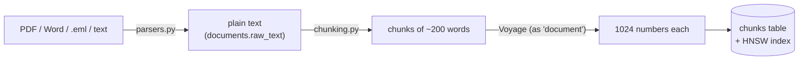
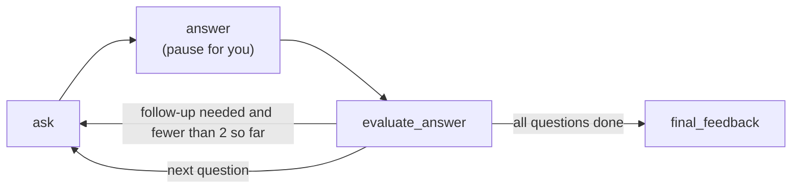
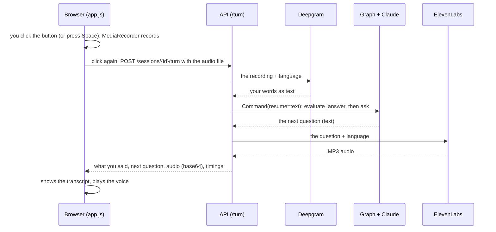
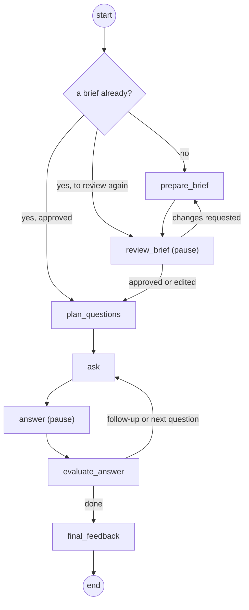

# How it works

A guide to the whole codebase, for beginners and intermediate developers. It explains what each part does, how the parts talk to each other, and why it is built this way. Read it top to bottom once. After that, use the file tour (section 4) and the recipes (section 14) as a reference.

The goals, the phases and the decisions behind them are in [plan.md](plan.md). This file explains the code as it is today.

---

## 1. What the app does

The app runs a **mock job interview**, ending with a **scored feedback report**:

1. You describe an upcoming interview (company, role, interview type, language) and add documents, pasted or as files (PDF, Word, .eml emails): the job post, recruiter emails, call notes, your CV.
2. Claude reads them and writes a short **Interview Brief** (readable in under two minutes): the 3 things to focus on, what the company does, the format and interviewers, what the role needs, the gaps between your CV and the role, and the 5 likely questions.
3. You review the brief and approve it, edit it, or ask for changes.
4. Claude plays the interviewer: it asks questions one at a time, scores each answer and asks follow-ups when an answer is vague. Before each question it searches your documents for the passages that matter, so questions refer to your real CV and the real role.
   There are four interview types: behavioral / HR, tailored to the job post, technical backend, and system design. The two technical ones start from a bank of seeded questions.
5. At the end, Claude writes a feskedback report: scores, strengths, and concrete fixes.

You use it from a web page at http://localhost:8000: you click a button, speak your answer and click again, and the interviewer talks back (Phase 2). The interview can be in English, French or Spanish. You can also type your answers, on the page (switch Voice off) or in a terminal.

---

## 2. The big picture

```mermaid
flowchart LR
  you["You: web page (web/)<br/>or terminal (scripts/interview_cli.py)"] -- HTTP --> api["FastAPI server<br/>app/main.py, app/api/"]
  api -- your recording --> stt["Deepgram<br/>speech-to-text"]
  api -- runs --> graph["Interviewer graph<br/>app/graph/ (LangGraph)"]
  graph -- prompts --> claude["Claude<br/>Sonnet 5.5 and Haiku 5.5"]
  api -- next question --> tts["ElevenLabs<br/>text-to-speech"]
  graph -- saves progress --> db[("Postgres + pgvector<br/>tables, chunks, checkpoints")]
  api -- documents and questions --> voy["Voyage AI<br/>embeddings"]
  api -- reads and writes --> db
  claude -. every call recorded .-> ls["LangSmith<br/>traces"]
```

- The **web page** and the **CLI** contain no interview logic: they send HTTP requests to the server and show the replies.
- For a spoken answer, the server sends your recording to **Deepgram**, which turns it into text. The text goes through the graph exactly like a typed answer, and **ElevenLabs** then turns the next question into speech.
- The **server** (FastAPI) receives each request and runs the **graph** until it needs you again.
- The **graph** is the interviewer. It is a list of steps. Some steps call Claude; others pause and wait for your input.
- **Postgres** stores your interviews and documents, plus the graph's progress (called checkpoints), so you can stop and continue later.
- **Voyage AI** turns each piece of a document, and each search, into an embedding. **pgvector** (inside Postgres) finds the pieces closest to a question.
- **LangSmith** records every Claude call, so you can see exactly what was sent and what came back.

Everything except Claude, Deepgram, ElevenLabs, Voyage AI and LangSmith runs on your machine, in two **Docker** containers: `api` (the server) and `db` (Postgres).

---

## 3. The tools, in plain words

| Tool | What it is | Where it's used |
| --- | --- | --- |
| **Docker / Docker Compose** | Runs programs in isolated "containers", so the app runs the same on every machine. Compose starts several containers together from one file. | [docker-compose.yml](docker-compose.yml), [Dockerfile](Dockerfile) |
| **FastAPI** | A Python framework for building web APIs. You write a function, FastAPI turns it into a URL and checks the incoming JSON. | [app/main.py](app/main.py), [app/api/](app/api/) |
| **Uvicorn** | The web server that runs the FastAPI app. `--reload` restarts it when code changes. | started by docker-compose.yml |
| **Pydantic** | Describes the shape of data with Python classes and validates it ("this field must be text"). | request bodies, Claude's answers ([schemas.py](app/graph/schemas.py)), settings |
| **PostgreSQL** | The database. | the `db` container |
| **pgvector** | A Postgres extension for storing embeddings (lists of numbers that capture what a text means) and finding the closest ones. | [migration 0004](app/db/migrations/versions/0004_chunks_and_question_bank.py), [retrieve.py](app/rag/retrieve.py) |
| **Voyage AI** | Turns a text into an embedding of 1024 numbers (model `voyage-4`). Anthropic has no embedding model and recommends Voyage. | [app/rag/embeddings.py](app/rag/embeddings.py) |
| **pypdf, python-docx** | Read the text out of PDF and Word files. Emails (.eml) are read with Python's own `email` library. | [app/rag/parsers.py](app/rag/parsers.py) |
| **SQLAlchemy** | Lets Python code work with database rows as objects instead of writing SQL. | [app/db/models.py](app/db/models.py) |
| **Alembic** | Creates and changes database tables through numbered "migration" files, and tracks which ones have already run. | [app/db/migrations/](app/db/migrations/) |
| **LangGraph** | A library for building step-by-step AI workflows as a graph. It can save progress (checkpointer) and pause for a human (interrupt). | [app/graph/](app/graph/) |
| **Claude (Anthropic API)** | The AI model. Sonnet 5.5 for careful work (brief, plan, feedback), Haiku 5.5 for fast turns (asking, scoring). | [app/llm.py](app/llm.py) |
| **LangSmith** | A tracing service: records every Claude call and graph step so you can inspect and debug them. | [app/llm.py](app/llm.py) (`wrap_anthropic`) |
| **Deepgram** | Speech-to-text (STT): turns your recorded answer into text. Model `nova-3`, English, French and Spanish. | [app/voice/stt.py](app/voice/stt.py) |
| **ElevenLabs** | Text-to-speech (TTS): turns the interviewer's words into a natural voice. Model `eleven_flash_v2_5`, built for low latency. | [app/voice/tts.py](app/voice/tts.py) |
| **httpx** | A Python HTTP client, used to call Deepgram and ElevenLabs. | app/voice/ |
| **MediaRecorder** | The browser's built-in recorder: it captures the microphone between your clicks on the button. | [web/app.js](web/app.js) |
| **pytest** | Runs the automated tests. | [tests/](tests/) |

---

## 4. A tour of the files

```
app/
  main.py              The server's entry point: starts the checkpointer, mounts the routes, /health
  config.py            Settings read from .env (models, limits, database URL)
  llm.py               The only place that calls Claude: structured() and text_reply()
  auth/                Accounts (Phase 4.6)
    passwords.py       Hashes and checks passwords (Argon2)
    tokens.py          The random login token in the cookie, and its hash
    invites.py         Invite codes: make one for an email, check one at registration
    deps.py            current_user: who is calling, or 401
    ownership.py       owned_interview / owned_document / owned_session: yours, or 404
    routes.py          /auth/login, /auth/logout, /auth/me
  api/
    interviews.py      Interviews, and documents: paste, upload, list the CV, delete
    sessions.py        Start a session, resume it with your reply, retry a failed step
  graph/               The interviewer (LangGraph)
    state.py           What the graph remembers (the "state")
    nodes.py           The 7 steps and the 3 routing functions
    build.py           How the steps are connected
    schemas.py         The shapes Claude must answer in (brief, plan, scores, feedback)
    prompts.py         Loads prompts/*.md and rubrics/*.yaml
    checkpointer.py    Saves the graph's progress in Postgres
  voice/
    __init__.py        SpeechError, and the supported languages (en, fr, es)
    stt.py             Speech-to-text: the interface + Deepgram
    tts.py             Text-to-speech: the interface + ElevenLabs
  rag/                 Searching your documents (retrieval-augmented generation)
    parsers.py         PDF, Word, .eml and text files -> text (and HTML -> text)
    webpage.py         A link -> the page's readable text
    chunking.py        Text -> chunks of a few paragraphs
    embeddings.py      The embedding interface + Voyage AI
    ingest.py          Document -> chunks -> embeddings -> chunks table
    retrieve.py        Question -> closest chunks, or closest question-bank questions
  db/
    models.py          Tables as Python classes: Interview, Document, Chunk, QuestionBankItem, Session, User, LoginSession, Invite
    session.py         Database connection, and get_db() for routes
    migrations/        Alembic: env.py, the template, and versions/0001 to 0007
prompts/               Every text sent to Claude, one file per step, plus modes/ (the 4 interview types)
rubrics/               Scoring criteria per interview type (YAML)
question_bank/         Seeded questions for the technical backend and system design types (YAML)
scripts/
  interview_cli.py     The terminal interview (the "client"); logs in first
  create_user.py       Creates an account (your own admin account, or a test one)
  create_invite.py     Creates a one-use invite code for one email (printed once)
  smoke_claude.py      Quick check that the key, models and tracing work
  seed_question_bank.py  Loads question_bank/ into the database and embeds it (runs on every start)
  embed_documents.py   Embeds documents that have no chunks yet
  check-phase0.ps1     Phase 0 check in one command
web/
  index.html           The web page: login, setup (3 steps + My CV), brief, interview, feedback
  app.js               Its logic: login, API calls, click-to-talk recording, audio playback, end / leave
  style.css            Its look: a 7-color palette (listed in CLAUDE.md), two columns on wide screens, light / dark
samples/               A fictional job post and CV for testing
my_docs/               Your real CV, job posts and emails (ignored by git: never committed)
tests/                 Tests with a fake Claude, fake speech and a fake embedder, on their own database
evals/audio/           Your recorded answers, when SAVE_AUDIO=true (never committed)
docker-compose.yml     The two containers: api and db
Dockerfile             How the api image is built
requirements.txt       Python packages
alembic.ini            Alembic settings
pytest.ini             pytest settings
langgraph.json         Tells LangGraph Studio where the graph is (see section 13)
.env.example           Template for .env (your keys; .env is never committed)
README.md              The public overview: what the app does, the stack, how to run it
plan.md                Goals, stack, phases
CLAUDE.md              Rules for working on this repo (headers, this guide, commits)
```

Every file starts with a header that explains it in more detail, so open any file and read its first lines.

---

## 5. Follow one interview from start to finish

This section follows one real session through the code.

### Step 0: the containers start

`docker compose up -d` starts two containers ([docker-compose.yml](docker-compose.yml)):

1. **db** starts Postgres. Compose waits until it accepts connections (the `healthcheck`).
2. **api** runs `alembic upgrade head`, which creates any missing tables (migrations 0001 to 0007). It then runs [seed_question_bank.py](scripts/seed_question_bank.py), which loads `question_bank/*.yaml` into the database and embeds any new question (if Voyage is unreachable it says so and carries on). Finally it starts uvicorn on port 8000. Both ports (8000 for the app, 5433 for Postgres) are bound to `127.0.0.1`, so only your own computer can reach them, not other devices on your Wi-Fi. That matters because the database password is simply `app`, and the API serves your stored CV and documents.
3. While starting, [app/main.py](app/main.py) (`lifespan`) opens a pool of database connections. It then calls `saver.setup()`, which creates LangGraph's checkpoint tables if they don't exist, and builds the graph with `build_graph().compile(checkpointer=saver)`.

You can check it with `GET http://localhost:8000/health` → `{"status":"ok","db":"ok","pgvector":"0.8.7"}`.

### Step 0b: you log in

Every interview and session route needs a login; only `/health`, `/auth/login`, `/auth/register` and the page itself are public. [app/main.py](app/main.py) mounts those routes with `dependencies=[Depends(current_user)]`, so FastAPI runs [deps.py](app/auth/deps.py) before each of them.

1. **Create your account once:** `docker compose exec api python scripts/create_user.py --email you@example.com --admin`. It asks for a password (at least 10 characters) and stores only its **Argon2 hash** ([passwords.py](app/auth/passwords.py)) in the `users` table. Admin accounts are only made this way.
2. **Log in:** the page calls `GET /auth/me` on load. A 401 shows the login screen. `POST /auth/login` checks the password against the hash, creates a random token ([tokens.py](app/auth/tokens.py)), stores its SHA-256 hash in `login_sessions`, and sends the token back as a **cookie** named `login`.
3. **Every request after that:** the browser sends the cookie by itself. `current_user` hashes it, finds the matching `login_sessions` row (not expired, account not disabled) and lets the request through. Otherwise it's a 401, and the page shows the login screen again; logging in continues where you were.
4. **Log out:** `POST /auth/logout` deletes the row, so that cookie stops working at once, even if someone copied it. The page also forgets its session id and draft (the browser may be shared).

Why these choices:
- **Hash, not password:** the database never holds a password; Argon2 is deliberately slow, so a stolen database can only be guessed at very slowly. A wrong email and a wrong password get the same message, and the check takes the same time, so nobody can find out who has an account.
- **The cookie** is `HttpOnly` (page scripts can't read it, so injected JavaScript can't steal it), `SameSite=Lax` (other websites can't make your browser send it with their requests) and, with `COOKIE_SECURE=true` behind HTTPS, sent over HTTPS only. It lasts `LOGIN_DAYS` (30 by default).
- **Only the token's hash is stored**, so the `login_sessions` table can't be used to log in either.

The terminal CLI logs in the same way, with `INTERVIEW_EMAIL` / `INTERVIEW_PASSWORD` or by asking, and keeps the cookie in memory for the run. ### Step 0b-bis: someone you invite creates their account

1. **You make a code:** `docker compose exec api python scripts/create_invite.py --email marie@example.com --note "Marie"` prints a code such as `K7QM-2XPA-9RTD`, once. You send it, with the email you typed, to that person. ([invites.py](app/auth/invites.py): 12 random characters from 31 that can't be confused, like 0 and O; about 59 bits, far too many to guess.)
2. **They register:** on the login screen, **Create an account** (or http://localhost:8000/#register) asks for their email, a password and the code. `POST /auth/register` ([routes.py](app/auth/routes.py)) checks the code: its hash must match an `invites` row that is unused, not expired (14 days by default, `--days`) and made for **this email**. Lowercase, spaces and missing dashes don't matter.
3. **The account is created** and they are logged in at once (same cookie as a login). The invite is marked used (`used_at`, `used_by`) in the same database transaction, and the row is locked while it is checked (`SELECT ... FOR UPDATE`), so two registrations sent at the same moment can't both use one code.

Why it is built this way:
- **One code, one person, one email:** a forwarded code is useless to anyone else, and a used code is refused.
- **Same message for every bad code** (unknown, expired, used, or another email's), so trying codes teaches nothing. Only with the right code for that email does the answer say "this email already has an account: log in instead".
- **Checked before spending:** a too-short password or a malformed email is refused before the code is touched, so the person can simply try again.
- **Only the code's hash is stored** (like login tokens), so the database can't be used to register. A lost code can't be shown again: make a new one.

### Step 0c: you only see your own data

Every interview, document and chunk has a `user_id` (migration 0006); a session belongs to its interview. So:

- **New rows get your id:** `create_interview` and the document routes set `user_id=user.id`, and ingestion copies it into each chunk.
- **Every id in a URL is checked:** routes load rows through [ownership.py](app/auth/ownership.py) (`owned_interview`, `owned_document`, `owned_session`). Someone else's id answers **404, not 403**: a 403 would confirm the id exists, so with 404 another user's interview looks exactly like one that was never created. You also can't attach a document to someone else's interview.
- **Your CV is yours:** a CV is a document with no `interview_id` and your `user_id`. `GET /documents/cv` lists only yours, a new session's brief reads only this interview's documents and your CV, and the search ([retrieve.py](app/rag/retrieve.py)) only looks at chunks whose `user_id` is the interview's owner. The owner is looked up from the interview row inside the query, so even though the graph only knows the interview id, a search can never reach another user's chunks.

**Data from before accounts:** migration 0006 gives every existing row to the oldest admin account (or the oldest account). If there is data but no account, it stops with a message; create your account with `docker compose run --rm api python scripts/create_user.py --email you@example.com --admin` (a one-off container, which works even while the server can't start), then `docker compose up -d`.

### Step 1: create the interview and add documents

On the web page (http://localhost:8000), go through the three steps from left to right, one at a time (**Next** / **Back**, a swipe, or a click on the step bar): 1 the interview, 2 the company and the job (a link to the job post or its full text on the left; company pages, notes and files on the right), 3 your CV; then press **Prepare my interview brief**. Links are read by the server ([webpage.py](app/rag/webpage.py), `POST /documents/from-url`): it downloads the page, keeps its readable text (no menus or scripts, at most 30,000 characters) and stores it like any other document. Pages that need JavaScript or a login (often LinkedIn) can't be read: the page then asks you to paste the text. Step 3 shows the CV already stored, with a **Delete** button; adding a new one with "Replace my stored CV" ticked deletes the old one after the new one is saved, so only one CV feeds your briefs. Or, in a terminal (any of the paths can be a PDF, Word, .eml or text file):

```powershell
python scripts/interview_cli.py new --company "Northwind Logistics" --role "Senior Backend Engineer" `
  --doc job_post:samples/job_post.txt --cv samples/cv.txt
```

Both send the same requests:

- `POST /interviews` `{"company": "...", "role": "...", "mode": "behavioral", "language": "en"}` → [interviews.py](app/api/interviews.py) `create_interview` adds a row to the `interviews` table.
- `POST /documents` (pasted text) or `POST /documents/upload` (a file) for the CV, with no `interview_id`. Your CV is stored once and shared by all your interviews (other users have their own).
- The same for the job post and any emails or notes, with the interview's id.

### Step 1b: your documents become searchable

Each new document is **ingested** right after it is saved ([ingest.py](app/rag/ingest.py)):



1. [parsers.py](app/rag/parsers.py) extracts the text. A scanned PDF (images only) has no text and is refused with a clear message; email attachments are ignored.
2. [chunking.py](app/rag/chunking.py) cuts it into chunks of a few paragraphs (up to 1,200 characters), each starting with the end of the previous one, so no sentence is lost at a boundary.
3. [embeddings.py](app/rag/embeddings.py) sends all chunks to Voyage in one request and gets an **embedding** for each: 1024 numbers that place the text in a "meaning space", where texts about the same thing are close together.
4. The chunks and their embeddings go into the `chunks` table, tagged with the interview, document type and file name.

The reply says how many chunks were made. If Voyage fails, the document is still saved, the reply has an `embedding_error`, and `scripts/embed_documents.py` can index it later. The whole document text is still what Sonnet reads for the brief; chunks are for the searches during the interview.

### Step 2: start a session, and the brief is written

The CLI sends `POST /interviews/{id}/sessions`. In [sessions.py](app/api/sessions.py) `start_session`:

1. Loads the interview's documents, plus your CV (only yours: see Step 0c).
2. Creates a `sessions` row. Its **thread_id** (the same value as the session id) is the label the checkpointer uses for this session's saved progress.
3. Builds the **initial state**: mode, company, role, documents, and `brief_approved: False`.
4. Calls `graph.invoke(initial_state, config)`. LangGraph starts running steps.

The graph starts by asking `route_start`: "is there already an approved brief?" No, so it goes to **`prepare_brief`** ([nodes.py](app/graph/nodes.py)):

- It fills [prompts/prepare_brief.md](prompts/prepare_brief.md) (the instructions) and wraps each document in a `<document>` tag.
- It calls `structured(..., schema=InterviewBrief)` with Sonnet. Claude must answer in exactly the `InterviewBrief` shape, and gets back a Python object.
- It returns `{"brief": {...}}`. LangGraph merges that into the state and saves a checkpoint.

Then **`review_brief`** runs and calls `interrupt({"type": "review_brief", "brief": ...})`. The graph **pauses**: `graph.invoke` returns and the API answers the CLI with a "view":

```json
{
  "session_id": "8ac19f5b-...",
  "status": "waiting",
  "pending": {"type": "review_brief", "brief": {"company_summary": "...", "...": "..."}},
  "q_index": null,
  "total_questions": 0,
  "final_feedback": null
}
```

### Step 3: you review the brief

The web page shows the brief as six numbered cards you scroll from left to right (focus on, the company, the interview, the role needs, your gaps, likely questions), shown one at a time with a round arrow on each side (or the keyboard ← →), then **Approve and start the interview** and **Ask for changes** underneath. **‹ Back to my documents** reopens the setup form on the CV step with everything still filled in; if you change something (company, role, type, language, number of questions, a pasted text, a link, a file or your CV), **Prepare my interview brief** updates the same interview and writes a new brief; if nothing changed, the button reads **Back to my brief** and keeps the same brief, without calling Claude again. The CLI prints it and asks for approve / request changes / edit. Both then send `POST /sessions/{id}/resume`:

- approve: `{"value": {"action": "approve"}}`
- ask for changes: `{"value": {"action": "revise", "feedback": "the interviewer is the CTO, not the EM"}}`
- edit it yourself: `{"value": {"action": "edit", "brief": {...your edited brief...}}}`

`resume_session` first checks that your reply fits what the graph is waiting for (a decision for a brief, text for a question), otherwise you get a 422 error. It then calls `graph.invoke(Command(resume=value), config)`.

**How the pause and resume work:** LangGraph reloads the saved state and runs `review_brief` again from its first line. This time `interrupt(...)` doesn't pause: it returns your reply. The node returns `brief_approved: True`, or `brief_feedback` if you asked for changes. The routing function `route_after_review` then sends the graph to `plan_questions`, or back to `prepare_brief`, which rewrites the brief using [prompts/revise_brief.md](prompts/revise_brief.md).

After the run, `_run()` copies the approved brief into the `interviews` table (`brief_status = "approved"`). A later session for the same interview skips straight to the questions.

### Step 4: the questions are planned

**`plan_questions`** (Sonnet) uses [prompts/interviewer_system.md](prompts/interviewer_system.md) as the system prompt, which contains the brief, and [prompts/plan_questions.md](prompts/plan_questions.md) with the rubric. It returns a `QuestionPlan` with 5 questions (the `NUM_QUESTIONS` setting), each with a `based_on` field saying what it comes from. It also resets the counters: `q_index = 0`, `followups = 0`, an empty transcript.

In the **technical backend** and **system design** types (their rubric has `uses_question_bank: true`), it first searches the question bank with the brief's focus areas and role requirements (`search_question_bank`), and gives Claude the closest seeded questions to use, adapt or ignore.

### Step 5: the question and answer loop



- **`ask`** first **searches your documents** (`retrieve.search_documents`): the planned question (or the follow-up's focus) is embedded as a "query", and Postgres returns the 3 closest chunks of this interview's documents and its owner's CV (`RETRIEVAL_K`). Then Haiku gets [prompts/ask.md](prompts/ask.md) with the transcript so far, those passages, and a directive: [ask_question.md](prompts/ask_question.md) for a new question, or [ask_followup.md](prompts/ask_followup.md) for a follow-up. Haiku writes what the interviewer says, in natural spoken words, and can use a detail from a passage ("you mentioned the RabbitMQ migration..."). The line is added to the transcript with `sources`: the files the passages came from. The web page shows them under the question ("Based on: cv.pdf, job_post.txt").
- **`answer`** pauses with `interrupt({"type": "answer", "question": ...})`. The CLI shows the question and you type your answer. The CLI then sends `POST /sessions/{id}/resume` with `{"value": "your answer"}`, and the answer is added to the transcript.
- **`evaluate_answer`** (Haiku) fills [prompts/evaluate_answer.md](prompts/evaluate_answer.md) with the rubric and this question's exchange, and returns an `AnswerEvaluation`: a score per criterion, an overall score, a summary, and whether to follow up and on what.
  - If Claude wants a follow-up **and** fewer than 2 have been asked on this question (`MAX_FOLLOWUPS`; 3 in system design, set by `max_followups` in its rubric), the node sets `followup_focus` and the graph goes back to `ask`.
  - Otherwise it moves to the next question (`q_index + 1`, `followups = 0`).
- **`route_after_evaluate`** picks the next step: `ask` again, or `final_feedback` once `q_index` has gone past the last question.

The code enforces the follow-up limit, not Claude, so it holds even if Claude keeps asking for more.

**Time:** the setup form has a **Duration** (30, 45, 60 or 90 minutes, sent as `duration_min` when the session starts). `plan_questions` records `interview_started_at`, and the session view returns both, so the page shows a countdown in the side panel (coral in the last 5 minutes, "Time's up" at 0, which also highlights **End interview and get feedback**). The interview is never ended automatically, so an answer in progress is not cut. While you record, the page shows an answer timer (`1:23 / 5:00`, the 5-minute limit per answer) and a "You ..." bubble; while the next question is prepared, an "Interviewer ..." bubble.

### Step 6: the final feedback

**Going back:** under the controls, **‹ The brief** stops this interview and starts a new session at the brief review with the same brief (`review_brief: true` when the session starts; `route_start` then goes to `review_brief`, and the brief is only rewritten if you ask for changes). **‹ The setup** opens the 3-step form filled in with this interview; if nothing changes, its last button reads **Back to my interview** and returns where you left off. Either way, the interview you leave stays saved.

**Ending early:** the **End interview and get feedback** button (under the answer controls) (or typing `/end` in the CLI) calls `POST /sessions/{id}/end`, which resumes the paused `answer` step with `{"end": true}` instead of an answer. The step drops the unanswered question, sets `ended_early`, and `route_after_answer` goes straight to `final_feedback`, whose prompt is told to judge only the questions you answered. It needs at least one answer; to leave without feedback, use **New interview** (top right): the session stays saved.


**`final_feedback`** (Sonnet) gets the whole transcript and every per-answer evaluation, and returns a short `FinalFeedback` (about 400 words): an overall score, a 2-3 sentence summary, one sentence per rubric criterion, for each question its number, score, a comment and "a stronger answer", up to 3 strengths and the 3 most important fixes. Each criterion also gets 2 ideas to raise its score next time (`improve`). The page shows the score and three cards you swipe through ("In short", "Fix first", "Keep doing") on the left and, on the right, the criteria and questions as lines you click to open: a criterion shows why it got its score and how to improve it, a question shows the comment, the stronger answer and your own exchange from the transcript (found with the question's number). The criterion names come from the rubric, sent in the session view. The graph reaches `END`. The API sets `sessions.ended_at` and returns `status: "done"` with the report, which the page or the CLI shows.

### The same turn, spoken

On the web page, steps 5 and 6 happen by voice. After you approve the brief, the page calls `POST /sessions/{id}/speak`, which sends the first question to ElevenLabs and plays the audio. Then, for each answer:



In [sessions.py](app/api/sessions.py), `_voice_turn` runs these three steps and times each one. The page shows the timings under the transcript, for example `Turn 2.8 s = listening 0.4 s + interviewer 1.9 s + voice 0.5 s`. The Phase 2 target is about 3 s per turn.

- The graph doesn't know whether you typed or spoke: it receives text either way. Voice is a layer around it.
- The audio comes back inside the JSON as **base64** (binary data written as plain text), so one reply carries the text and the sound together.
- If Deepgram hears nothing, the API answers 422 and the question stays. If ElevenLabs fails, the interview still moves on and the page shows the question as text.
- The **language** of the interview (en, fr or es) is passed to Deepgram (what to listen for), to ElevenLabs (how to pronounce), and into the prompts (what Claude writes).
- With `SAVE_AUDIO=true` in `.env`, every recording is also saved in `evals/audio/`, so voice problems can be replayed later without speaking again.

---

## 6. The graph in detail

### The full graph



It is built in [build.py](app/graph/build.py):
- `add_node` registers a step.
- `add_edge` is an arrow that always goes the same way.
- `add_conditional_edges` is a fork: a routing function in `nodes.py` returns the name of the next step.

### The state

The state is one dictionary, described in [state.py](app/graph/state.py). Nodes don't change it directly. Each node **returns the keys it changed**, and LangGraph merges them in.

| Key | Set by | Meaning |
| --- | --- | --- |
| `mode`, `language`, `company`, `role`, `documents`, `num_questions` | the API, at start | what this session is about |
| `brief`, `brief_approved`, `brief_feedback` | prepare_brief, review_brief | the brief and your review of it |
| `questions` | plan_questions | the planned main questions |
| `q_index`, `followups`, `followup_focus` | plan_questions, evaluate_answer | where we are in the interview |
| `current_question`, `transcript` | ask, answer | the conversation so far; interviewer lines also carry `sources` |
| `evaluations` | evaluate_answer | one score record per answer |
| `final_feedback` | final_feedback | the report |

### Which model does what

| Step | Model | Effort | Why |
| --- | --- | --- | --- |
| prepare_brief, final_feedback | Sonnet 5.5 | high | quality matters, and a 20–40 s wait is fine |
| plan_questions | Sonnet 5.5 | medium | needs good judgement, but less work |
| evaluate_answer | Haiku 5.5 | medium | fast, and fair enough to score one answer |
| ask | Haiku 5.5 | low | you're waiting for it to speak |

*Effort* controls how much Claude thinks before answering: lower is faster and cheaper. You can change the models in `.env` (`MODEL_TURN`, `MODEL_REASONING`).

---

## 7. Where data is stored

There are two kinds of tables in the same Postgres database:

| Tables | Owned by | Holds |
| --- | --- | --- |
| `interviews`, `documents`, `sessions` | us ([models.py](app/db/models.py), created by Alembic migrations) | what you created: interviews (with their language), document texts, the list of sessions, approved briefs |
| `users`, `login_sessions`, `invites` | us (migrations 0005 and 0007; migration 0006 adds `user_id` to interviews, documents and chunks) | accounts (email, Argon2 password hash, admin, disabled) and logins (the hash of each cookie's token, its expiry) |
| `chunks`, `question_bank` | us (migration 0004) | the searchable pieces of your documents and the seeded questions, each with an embedding (`vector(1024)`) and an HNSW index for fast search |
| `checkpoints`, `checkpoint_blobs`, `checkpoint_writes`, `checkpoint_migrations` | LangGraph (created by `saver.setup()`) | the full graph state after every step, per thread_id: questions, transcript, scores, feedback |

A session row and its checkpoints are linked by `sessions.thread_id`. Answers and scores are only in the checkpoints for now. The `turns` and `feedback` tables from plan.md will be added when they are needed (Phase 4, for evaluations and thumbs up / down).

**Searching by meaning**, in short: `search_documents` asks Postgres for the chunks with the smallest **cosine distance** to the query's embedding (`ORDER BY embedding <=> query`). Distance 0 means the same meaning; the similarity shown in traces is 1 minus the distance. Without an index Postgres would compare the query with every row; the **HNSW** index is a graph of neighbouring vectors that finds the closest ones quickly.

**Tests use their own database**, `interview_test`, created automatically, so test interviews never mix with yours.

**Migrations**, in short: when a table changes, you don't edit the database by hand. You add a numbered file in `app/db/migrations/versions/` with an `upgrade()` (apply the change) and a `downgrade()` (undo it). Alembic remembers which migrations have run, and `alembic upgrade head` applies the new ones. The container runs it on every start.

---

## 8. Prompts and rubrics

- **Every text sent to Claude is in [prompts/](prompts/)**, one file per step. The code only fills in the blanks. Each file's header (an HTML comment) says which step uses it and which placeholders it has.
- **Placeholders** look like `$transcript` and are filled by `prompts.render("ask", transcript=..., directive=...)` ([prompts.py](app/graph/prompts.py)). If a value is missing, it raises an error, so a typo fails loudly instead of sending a broken prompt.
- **Interview types (modes)**: one of [behavioral.md](prompts/modes/behavioral.md), [job_post.md](prompts/modes/job_post.md), [technical_backend.md](prompts/modes/technical_backend.md) or [system_design.md](prompts/modes/system_design.md) is inserted as `$mode_guidance`. Together with the rubric (and, for the technical ones, the question bank), that's the only difference between interview types.
- **Retrieved passages** are inserted as `$context` in [ask.md](prompts/ask.md), and seeded questions as `$bank_questions` in [plan_questions.md](prompts/plan_questions.md). Both change every call, so they are in the user message, never in the cached system prompt.
- **Language**: `$language` (English, French or Spanish) is filled into [interviewer_system.md](prompts/interviewer_system.md), [prepare_brief.md](prompts/prepare_brief.md) and [final_feedback.md](prompts/final_feedback.md), so the interview, the brief and the report are all in the interview's language, whatever language the documents are in.
- **Rubrics**: [rubrics/behavioral.yaml](rubrics/behavioral.yaml) lists the criteria and the 1–5 scale. `rubric_text()` turns the file into text for the prompts. A rubric can also set `uses_question_bank: true` and `max_followups`.
- **Files are re-read on every call.** Save a prompt and the next question already uses the new version, without restarting anything. Git keeps each version.
- **Prompt caching**: [interviewer_system.md](prompts/interviewer_system.md), which includes the brief, is sent unchanged on every turn. Claude caches it, so later turns are cheaper and faster. Anything that changes every turn goes in the user message (`ask.md`, `evaluate_answer.md`), never in the system prompt.

---

## 9. Talking to Claude

All calls go through [app/llm.py](app/llm.py):

- **`structured(model, system, user, schema, ...)`**: Claude must answer as JSON matching a Pydantic class (`schema`). The SDK checks the reply and returns a Python object, such as `brief.company_summary`. There's no fragile text parsing.
- **`text_reply(...)`**: plain text, for what the interviewer says.
- **Tracing**: the client is wrapped with `wrap_anthropic`, so every call appears in LangSmith.
- **Refusal fallback** (`fallback=True`, Sonnet calls only): if Sonnet declines a request, the API automatically retries it on a backup model.
- **Errors**: if Claude refuses, runs out of tokens, or returns nothing usable, `LLMError` is raised. The API turns it into a `502` error with a hint to retry.

---

## 10. Errors, retries and resuming

- **Stopping mid-interview** (Ctrl+C, closing the terminal, restarting Docker) loses nothing: the state was saved after the last step. `python scripts/interview_cli.py resume SESSION_ID` continues where you stopped.
- **A failed Claude call** leaves the session at its last checkpoint, with status `stopped`. `POST /sessions/{id}/retry` runs the graph again from there with `graph.invoke(None, config)`, which re-runs the step that failed. The CLI offers this automatically.
- **A wrong reply** (text when a brief decision is expected, or the reverse) is rejected with `422` before the graph runs, so the session is unaffected.
- **Speech problems**: if Deepgram fails (`502`) or hears nothing (`422`), the graph isn't touched and you answer the same question again. If ElevenLabs fails, the turn still counts and `audio_error` explains why there is no voice.
- **Reloading the web page** continues the same session: the page remembers the last session id in your browser.
- **Voyage problems**: a search that fails (no key, network, rate limit) is skipped with a warning in the logs: the question is asked without passages, the interview doesn't stop. Document embedding retries for about a minute on a rate limit (`429`), then reports `embedding_error`. A Voyage account **without a payment method is limited to 3 requests per minute**, which a fast interview can exceed; adding a payment method raises it (the first 200M tokens stay free).

---

## 11. Seeing what happened: LangSmith

Open [smith.langchain.com](https://smith.langchain.com), project **interview-prep-voice-agent**. Each API request that runs the graph shows up as a trace:
- the graph steps that ran,
- inside each step, the Claude call: the full prompt, the reply, the tokens used and the time taken.

Every search appears as a **retriever** step (`search_documents`, `search_question_bank`) inside the graph step that made it: LangSmith lists the passages found, with their `source` (the file), `doc_type` and `similarity`. That is how a trace shows which document each question came from.

A spoken turn is one trace named **voice_turn**, with `speech_to_text`, the graph steps and `text_to_speech` inside it, each with its duration. The audio itself is left out of the trace: only its size is kept.

When a question or score looks wrong, this is where you see why. You can copy the prompt into the LangSmith Playground, adjust it, then update the file in `prompts/`.

Privacy: traces contain everything sent to Claude, including your documents and answers.

---

## 12. Tests

```powershell
docker compose exec api pytest -q
```

[tests/test_graph_flow.py](tests/test_graph_flow.py), [tests/test_voice_turn.py](tests/test_voice_turn.py) and [tests/test_rag.py](tests/test_rag.py) replace Claude with a **fake** that returns fixed answers ([tests/conftest.py](tests/conftest.py)), and Deepgram, ElevenLabs and Voyage with fakes too. The fake embedder builds vectors from the words of a text, so texts sharing words are close: enough to test search without calling Voyage. Tests run on their own database (`interview_test`). The fake Claude asks for a follow-up whenever an answer contains the word "vague". This makes the tests free, fast and repeatable, and they still use the real prompts, graph, API and Postgres checkpointer. They check:
- brief revision, then approval;
- the follow-up cap of 2;
- that every question is asked and a final feedback is written;
- that an approved brief is reused;
- that a session survives an app restart;
- that the interview's language reaches the prompts and both speech providers;
- that a spoken turn goes through speech-to-text, the graph and text-to-speech, and that silence or a provider error leaves the question in place;
- that PDF, Word, .eml and text files are read, chunks stay small, uploads are chunked and found by search, and one interview never sees another's documents;
- registration ([tests/test_register.py](tests/test_register.py)): a valid code creates and logs in the account and is used up; sloppy typing is accepted; a code works once and only for its email; unknown, expired, used and other-email codes get the same answer and don't burn the code; weak passwords and existing accounts are refused without spending it; only the hash is stored;
- that each user sees only their own data ([tests/test_ownership.py](tests/test_ownership.py)): every interview, document and session route answers 404 to another user (and changes nothing), nobody can attach a document to someone else's interview, and another user's CV never reaches your CV list, your brief or your search;
- that the interviewer's prompt receives the matching passages and the transcript records their source;
- that the technical types use the question bank and that system design allows 3 follow-ups;
- accounts ([tests/test_auth.py](tests/test_auth.py)): routes answer 401 without a login, a wrong password and an unknown email look the same, the cookie is HttpOnly and SameSite=Lax, logout makes the old cookie useless, expired logins and disabled accounts are refused, and only hashes are stored.

**Logged in by default:** the other tests don't log in. A fixture in [conftest.py](tests/conftest.py) replaces `current_user` with a test account (`tests@example.com`) for every test; the account tests take the `real_auth` fixture, which turns that off and goes through the real cookie check.

They don't check how good Claude's answers are. That's the job of the evals in Phase 4.

`python scripts/smoke_claude.py` (inside the container) is the opposite: one real, tiny Claude call per model, to check your key, the model ids and tracing.

---

## 12b. Evaluations

Tests check that the code works; evaluations measure how *good* Claude's decisions are, on fixed cases, so a prompt change can be judged with numbers instead of impressions.

The first evaluation covers **answer scoring + follow-ups** (the `evaluate_answer` step), in [evals/answer_scoring/](evals/answer_scoring/):

- **Cases:** [cases.yaml](evals/answer_scoring/cases.yaml) holds 30 fictional answers (strong, adequate, generic, missing the result, "we" instead of "I", off-topic, no answer, cut off, completed by a follow-up, follow-up limit reached), each labelled with the score range and follow-up decision a fair interviewer would give, and why. Six more come from your real sessions and stay in `evals/private/` (git-ignored).
- **Runner:** [run.py](evals/answer_scoring/run.py) calls the real node on each case, records the model, tokens and time of each Claude call (`app.llm.record_calls()`), and grades by code: `score_in_range`, `off_by`, `follow_up_ok`, plus follow-up precision / recall / specificity for the whole run. A case that fails (Claude error, timeout) is counted as `invalid`, never as a wrong score.
- **Where to look:** each run is a LangSmith experiment on the dataset `interview-answer-scoring-<hash>` (the hash changes when the cases change), with every case's trace; select two experiments to compare them side by side. A local summary is saved in `evals/answer_scoring/runs/` and compared with the previous run.
- **Run it:** `./scripts/eval.ps1` (36 cases × 2 repetitions, about 2 minutes and $0.04).

## 13. Running it day to day

| I want to... | Command |
| --- | --- |
| start everything | `docker compose up -d` |
| create an account (your own: add `--admin`) | `docker compose exec api python scripts/create_user.py --email you@example.com` |
| invite someone (prints a one-use code for that email) | `docker compose exec api python scripts/create_invite.py --email them@example.com --note "who"` |
| see the server logs | `docker compose logs -f api` |
| stop everything | `docker compose down` |
| delete all data and start fresh | `docker compose down -v` |
| run a spoken interview | open http://localhost:8000 (Chrome, Edge or Firefox; allow the microphone) |
| run a typed interview in a terminal (it asks for your email and password, or reads `INTERVIEW_EMAIL` / `INTERVIEW_PASSWORD`) | `python scripts/interview_cli.py new --company "..." --role "..." --mode technical_backend --doc job_post:post.pdf --doc recruiter_email:mail.eml --cv cv.pdf` |
| index documents added before Phase 3 (or when Voyage failed) | `docker compose exec api python scripts/embed_documents.py` |
| reload the question bank after editing question_bank/ | `docker compose exec api python scripts/seed_question_bank.py` (also runs on every start) |
| see or remove your stored CV | `GET /documents/cv`, then `DELETE /documents/{id}` (from http://localhost:8000/docs) |
| practice again on an approved brief | `python scripts/interview_cli.py start INTERVIEW_ID` |
| continue a session | `python scripts/interview_cli.py resume SESSION_ID` |
| try the API by hand | open http://localhost:8000/docs |
| run the tests | `docker compose exec api pytest -q` |
| check Claude and LangSmith | `docker compose exec api python scripts/smoke_claude.py` |
| open a database shell | `docker compose exec db psql -U app -d interview` |
| after editing requirements.txt | `docker compose up -d --build` |
| after editing .env | `docker compose up -d --force-recreate api` (the container reads .env when it is created) |

**LangGraph Studio** (optional, not tested yet) shows the graph visually and lets you run steps one by one. [langgraph.json](langgraph.json) tells it where the graph is (`app/graph/build.py:graph`) and to load `.env`. To use it, install the CLI on your machine (`pip install "langgraph-cli[inmem]"`), then run `langgraph dev` in the project folder.

Postgres is on port **5433** on your machine, not the usual 5432. The database name, user and password are `interview` / `app` / `app`, for local use only.

---

## 14. How to change things

**Improve a prompt.** Edit the file in `prompts/` and save. The next call uses it. Keep the `$placeholders` the step expects; they're listed in the file's header.

**Change how answers are scored.** Edit the criteria in `rubrics/<mode>.yaml`. No code changes are needed.

**Change a model or a limit.** Set it in `.env` (`MODEL_TURN`, `MODEL_REASONING`, `NUM_QUESTIONS`, `MAX_FOLLOWUPS`), then run `docker compose up -d --force-recreate api`.

**Change the voice.** Pick a voice in your ElevenLabs account, copy its id into `ELEVENLABS_VOICE_ID` in `.env`, then run `docker compose up -d --force-recreate api`. `TTS_MODEL` and `STT_MODEL` switch models the same way.

**Add a speech provider** (e.g. to compare with Deepgram):
1. Write a class with the same method as the interface: `transcribe(audio, mime_type, language)` in [stt.py](app/voice/stt.py), or `synthesize(text, language)` in [tts.py](app/voice/tts.py).
2. Return it from `get_stt()` / `get_tts()` when `STT_PROVIDER` / `TTS_PROVIDER` has its name.
3. Nothing else changes.

**Add a language**:
1. Add it to `LANGUAGES` in [app/voice/__init__.py](app/voice/__init__.py), to `Language` in [interviews.py](app/api/interviews.py), and to the language lists on the page and in the CLI.
2. Check that Deepgram's `nova-3` and ElevenLabs' model support it.

**Add questions to the bank.** Add entries (topic, difficulty, text) to `question_bank/technical_backend.yaml` or `system_design.yaml`, then run `docker compose exec api python scripts/seed_question_bank.py`. Only the new questions are embedded.

**Tune the search.** `RETRIEVAL_K` in `.env` sets how many passages each question gets. Chunk size is `max_chars` in [chunking.py](app/rag/chunking.py); after changing it, run `scripts/embed_documents.py --all`.

**Add an interview mode** (e.g. `product_sense`):
1. Add `prompts/modes/product_sense.md`.
2. Add `rubrics/product_sense.yaml` (add `uses_question_bank: true` and a `question_bank/product_sense.yaml` if it should start from seeded questions).
3. Add the name to `Mode` in [app/api/interviews.py](app/api/interviews.py), to the select on the web page ([index.html](web/index.html)), and to `--mode` in the CLI.

**Add a column or table:**
1. Change [app/db/models.py](app/db/models.py).
2. Run `docker compose exec api alembic revision --autogenerate -m "add X"`.
3. Read the generated file in `migrations/versions/` and fix it if needed.
4. Run `docker compose restart api`, which applies it.

**Add a graph step:**
1. Write the function in [nodes.py](app/graph/nodes.py). It should return only the keys it changes.
2. Add any new keys to [state.py](app/graph/state.py).
3. Connect it in [build.py](app/graph/build.py).
4. Put its prompt in `prompts/`.
5. Extend the fake in the tests.

**Add an API route.** Add a function with `@router.get/post(...)` in a file in `app/api/`, with a Pydantic model for the body.

---

## 15. Glossary

- **API / route / endpoint**: a URL the server answers, such as `POST /sessions/{id}/resume`.
- **Checkpointer**: saves the graph's state after every step, so it can resume later.
- **Container**: an isolated, reproducible environment that runs one program (here: the server, or Postgres).
- **Argon2 / password hash**: a one-way fingerprint of a password; the login check hashes what you type and compares. Argon2 is slow on purpose, to make guessing expensive.
- **Base64**: a way to write binary data (like audio) as plain text, so it fits inside JSON.
- **Effort**: how much Claude thinks before answering (low, medium or high).
- **Cookie**: a small value the server asks the browser to keep and send back with every request; here it holds the random login token.
- **Chunk**: a piece of a document (a few paragraphs) that is embedded and searched on its own.
- **Cosine distance / similarity**: how far apart two embeddings point; similarity 1 means the same meaning, 0 unrelated.
- **Embedding**: a list of numbers representing the meaning of a text; similar texts have nearby numbers.
- **HNSW index**: a search index that links each vector to its neighbours, so the closest vectors are found without checking every row.
- **401 / Unauthorized**: the HTTP answer meaning "log in first".
- **Interrupt**: a pause inside a graph step that waits for a human. It is resumed with `Command(resume=...)`.
- **Migration**: a numbered script that changes the database's tables in a controlled way.
- **Node**: one step of the graph, written as a Python function.
- **ORM**: a library (here SQLAlchemy) that maps database rows to Python objects.
- **Prompt caching**: Claude reuses a prompt prefix it has just seen, so repeated system prompts are cheaper and faster.
- **RAG (retrieval-augmented generation)**: searching your own documents for the relevant passages and adding them to the prompt, instead of sending everything every time.
- **Click-to-talk**: you click (or press Space) to start recording and again when you're done, so the app knows exactly where your answer ends, without having to guess from silences.
- **Schema (Pydantic)**: a Python class describing the exact shape data must have.
- **Speech-to-text (STT)** / **text-to-speech (TTS)**: turning a recording into text, and text into a voice.
- **State**: the dictionary the graph carries from step to step.
- **Structured output**: Claude answers as JSON that is guaranteed to match a schema.
- **Thread id**: the label under which one session's checkpoints are saved (here: the session id).
- **Trace**: LangSmith's recording of one run: each step and each Claude call, with inputs and outputs.

---

## 16. Where the project is

| Phase | Status |
| --- | --- |
| 0. Skeleton: Docker, FastAPI, Postgres + pgvector, migrations, traced Claude call | done |
| 1. Typed interview with brief review, Postgres checkpointer, prompts and rubrics in files | built; brief tested with real Claude, the full typed check is yours to run |
| 2. Voice: speech-to-text, text-to-speech, one-page web UI, English / French / Spanish | built and tested with fake providers; the spoken check (under ~3 s per turn) needs the Deepgram and ElevenLabs keys |
| 3. File uploads (PDF, Word, .eml), pgvector search per question, question bank, technical backend and system design types | built; tested offline (fake embedder) and with real Voyage (question bank, document search). The trace check is yours to run |
| 4. Evals in LangSmith | planned |
| 4.5. Cost control: a $10 / month budget, per-session limits, spend recorded per call | planned (after 4.6, so it can count per user) |
| 4.6. Accounts: email, password and an invite code; each user sees only their own data | steps 1-3 built and tested: login, logout, login screen, CLI login; each user sees only their own data; invite codes and registration. Next: hardening (login limits, Origin check, delete my account, admin scripts) |
| 5. AWS with Terraform | planned |
| 6. Streaming, live turn detection, personas and more | planned |

The details of each phase are in [plan.md](plan.md).
