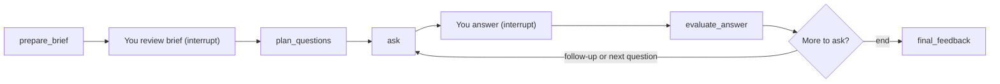

# Interview Prep Voice Agent — Plan

Source of truth: the Claude Docs version of this plan. This file is a Markdown copy for Claude Code and other surfaces (as of 2026-11-19).

## Goal and principles

A voice agent that runs realistic mock interviews from the documents I upload about a company and a role, then gives scored feedback. A local MVP first (Docker Compose), then AWS.

- **Interview types:** behavioral / HR, technical backend, system design, and tailored to a job post.
- **MVP first:** a push-to-talk web page running locally; streaming and live turn detection come later.
- **Control:** the graph pauses explicitly at every human step, prompts are versioned in files, models and providers are set in config, and each phase ends with a check I run myself.
- **Traceability:** every turn is one LangSmith trace (STT, each graph node, LLM calls, TTS).
- **Portfolio-grade:** evals, Terraform and an architecture README, so the project can be shown in interviews.

## Fast iteration loop

The goal is to change one thing and test it again within seconds, without rebuilding or speaking every time.

| To check | How | Time |
| --- | --- | --- |
| A code or prompt change | `docker compose up` once; code mounted as a volume, `uvicorn --reload`; prompts re-read from `prompts/` on each call | Seconds, no rebuild |
| The graph logic | Text mode: same graph, typed answers (toggle on the web page) | No speaking needed |
| One node, step by step | LangGraph Studio (`langgraph dev`): see the graph, step through nodes, inspect and edit the state, replay from a checkpoint | Minutes |
| A bad turn | Open its LangSmith trace, rework the prompt in the Playground, then add the turn to the eval dataset | Minutes |
| A voice issue | Replay saved audio files (`evals/audio/`) through the pipeline | No speaking needed |
| Nothing got worse | `./scripts/eval.ps1` runs the LangSmith eval suite and compares with the last run | A few minutes |

## Stack

Claude does the reasoning. The speech, voice and embedding providers each sit behind an interface, so a swap is a config change.

| Component | Choice | Status | Why |
| --- | --- | --- | --- |
| LLM, each interview turn | Claude Haiku 5.5 | Decided | Fast enough for spoken turns |
| LLM, brief and final feedback | Claude Sonnet 5.5 | Decided | Better reasoning; speed matters less |
| Speech-to-text | Deepgram (Nova-3 / Flux) | Decided | Most common pick for voice agents; streaming and end-of-speech detection; multilingual |
| Text-to-speech | ElevenLabs (Flash v2.5) | Decided | Most natural voices; French and Spanish |
| Embeddings | Voyage AI (`vector(1024)`) | Decided | Anthropic has no embedding model and recommends Voyage |
| Orchestration | LangGraph + LangChain | Decided | Explicit state graph, `interrupt()` for human steps |
| Storage | PostgreSQL + pgvector | Decided | Interview state (checkpointer), documents, vectors |
| API | FastAPI (Python) | Decided | Async, simple |
| Tracing and evals | LangSmith | Decided | Traces, datasets, evaluators |
| Local run | Docker Compose | Decided | `api` + `db` (pgvector image) |
| Cloud | AWS: ECS Fargate, RDS, S3, ECR, ALB, Secrets Manager | Decided | |
| Infrastructure as code | Terraform | Decided | State in S3 |
| Local machine | Windows, PowerShell, Docker Desktop | Given | Scripts in PowerShell |

## Architecture

```
Browser (push-to-talk page)
   │ audio                                  ▲ audio + transcript back
   ▼                                        │
Speech-to-text (Deepgram) ──text──► Interviewer graph (LangGraph + Claude) ──reply──► Text-to-speech (ElevenLabs)
                                          │ state + retrieval                    ┆ traced
Browser ──uploads──► Voyage AI ──► Postgres + pgvector                        LangSmith
```

One FastAPI service in Docker Compose runs the three steps. Postgres keeps the interview state and the document vectors, and LangSmith records every step of every turn.

## Interview context

Each practice session belongs to an **Interview**: company, role, date, interviewer names, plus the documents I attach to it.

1. **Upload:** PDF, DOCX, `.eml` emails or pasted text (recruiter email, job post, notes from a call). Each file is parsed, split into chunks, embedded with Voyage and stored in pgvector, tagged with `interview_id`, `doc_type` and `source`. My CV is stored once and shared by all interviews.
2. **Brief, which I review:** Claude Sonnet reads all the documents and writes a structured Interview Brief (Pydantic model):
    - company summary and what the role requires
    - likely interview format, and who the interviewers are
    - gaps between my CV and the role
    - areas to focus on, and probable questions
3. **Approval:** the graph pauses with `interrupt()` so I can read, edit or approve the brief before the interview starts.
4. **During the interview:** the approved brief is always in the system prompt (short, prompt-cached). Each question also triggers a pgvector search for specific details. The retrieved chunks appear in the LangSmith trace.

**Privacy:** recruiter emails contain personal data, and LangSmith traces contain whatever is sent. Keep the MVP local, and mask inputs and outputs in LangSmith for the ingestion steps if needed.

## Interviewer graph



All four modes share this graph; they differ only in prompts, rubrics and question sources. Follow-ups are capped at 2 per question.

**State:** session ID, interview ID, mode, approved brief, message history, planned questions, current question index, follow-up count, scores.

## Data model

| Table | Holds | Key columns |
| --- | --- | --- |
| `interviews` | One upcoming interview | company, role, date, interviewers, mode, `brief` (JSON), brief status |
| `documents` | Uploaded files and pasted texts | `interview_id` (null for the CV), doc_type, source, S3 key / raw text |
| `chunks` | Searchable pieces of documents | `document_id`, text, `embedding vector(1024)`, metadata |
| `question_bank` | Seeded questions for technical and system design | mode, topic, difficulty, text, embedding |
| `sessions` | One practice run | `interview_id`, LangGraph `thread_id`, started / ended |
| `turns` | Each question and answer | `session_id`, question, transcript, score, LangSmith `run_id` |
| `feedback` | Final report and my rating of it | `session_id`, rubric scores, strengths, fixes, thumbs up / down |
| `usage` | Each paid API call (Phase 4.5) | provider, model, units, cost_usd, session_id, created_at |

LangGraph's Postgres checkpointer keeps its own tables for graph state.

## Cost control

All paid APIs together stay under **$10 a month** (AWS hosting is budgeted separately in Phase 5). At about $0.50 per spoken interview, that is about 20 interviews a month.

**Estimated cost of one spoken interview** (5 questions, about 10 turns, 15 minutes of answers). Prices are approximate as of November 2026; confirm them on each provider's pricing page.

| Provider | What is billed | Price | Per interview |
| --- | --- | --- | --- |
| Claude Sonnet 5.5 | brief, question plan, final feedback | $2 in / $10 out per million tokens | ~$0.20 |
| Claude Haiku 5.5 | each question and each score (~20 calls) | $0.10 in / $0.50 out per million tokens | ~$0.01 |
| ElevenLabs Flash v2.5 | ~4,000 characters spoken | ~$0.05 per 1,000 characters | ~$0.20 |
| Deepgram Nova-3 | ~15 minutes of recorded answers | ~$0.0043 per minute | ~$0.07 |
| Voyage voyage-4 | document chunks and search queries | $0.06 per million tokens, first 200M free | ~$0 |
| **Total** | | | **~$0.48** |

**Monthly budgets.** The app warns at 80% of a budget. At 100% it refuses new sessions, but an interview already running can finish and get its feedback. Each provider also gets its own cap in its console, as a safety net if the app's count is wrong.

| Provider | App budget (USD / month) | Cap at the provider |
| --- | --- | --- |
| Claude | 4.50 | workspace spend limit of $6 in the Claude Console |
| ElevenLabs | 4.00 | a plan with usage-based billing off, so it stops at its quota |
| Deepgram | 1.00 | prepaid credit only, no auto-recharge |
| Voyage | 0.50 | free tier; a payment method only to lift the 3 requests / minute limit |
| **All, per month** | **10.00** | |
| **All, per day** | **1.50** | stops a runaway day from using the month |

**Limits per session and per input**, so one session or one large file can't use up the budget:

| Limit | Value | Why |
| --- | --- | --- |
| Interviews started per day | 4 | backs up the daily budget |
| Brief revisions per session | 3 | each one is a Sonnet call at high effort (~$0.08) |
| Questions per session | 5 by default, 8 at most | each question adds Haiku calls, speech and feedback length |
| Follow-ups per question | 2 (3 for system design) | already in place |
| Recording length per answer | 3 minutes | Deepgram bills per second; the page stops recording at the limit |
| Spoken question length | 600 characters | ElevenLabs bills per character; longer questions are shown as text only |
| Question replays | free | each question's audio is saved, so a replay isn't billed again |
| Documents per interview | 10 files, 200,000 characters in total | they are all sent to Sonnet for the brief, and embedded |
| Web page imports | 3 per interview, 50,000 characters each | same reason |
| Eval run (Phase 4) | $1 per run, counted in the monthly budget | a full eval run calls Claude many times |

**How it is enforced:** a `usage` table records every paid call: provider, model, units (tokens, audio seconds, characters) and cost in dollars. Prices are kept in `pricing.yaml`, so a price change is a one-line edit. A guard checks the budgets before each session starts and before each paid call. The web page shows the month's spend. Every limit is set in `.env` (e.g. `BUDGET_MONTHLY_USD`). LangSmith's cost per trace is a cross-check for Claude.

## Phases

The MVP is done at the end of Phase 2. Each phase ends with a check I run myself before moving on.

### Phase 0: Skeleton (about half a day)
- [x] Repo, `docker-compose.yml` with `api` and `db` (pgvector image), `.env.example`
- [x] FastAPI `/health`, Alembic migrations, pgvector extension enabled
- [ ] API keys: Anthropic, Deepgram, ElevenLabs, Voyage, LangSmith

**Check:** `docker compose up` works and a test Claude call shows up in LangSmith.

### Phase 1: Text interview with the brief
- [x] Graph: `prepare_brief` → review → `plan_questions` → `ask` → answer → `evaluate_answer` → `final_feedback`
- [x] Pasted text only; all documents go straight into Claude's context, no embeddings yet
- [x] Postgres checkpointer, so a session can be stopped and resumed
- [x] Prompts in `prompts/`, rubric in `rubrics/`

**Check:** I approve a brief, then do a typed 5-question interview based on it and get final feedback.

### Phase 2: Voice (MVP)
- [x] Speech-to-text and text-to-speech interfaces, plus Deepgram and ElevenLabs implementations
- [x] One-page web UI: record button, transcript, audio playback (works on `localhost` without HTTPS)
- [x] `POST /sessions/{id}/turn` takes audio and returns audio and the transcript
- [x] Interview language per interview: English, French or Spanish (interviewer, voice, brief and feedback)

**Check:** a full spoken interview runs locally, at under about 3 s per turn.

### Phase 3: Uploads, pgvector and all modes
- [x] PDF, DOCX and `.eml` parsing, chunking, Voyage embeddings (`voyage-4`)
- [x] Per-question retrieval from pgvector (traced as retriever runs; the transcript records each question's sources)
- [x] Seed the question bank; add the technical backend and system design modes

**Check:** the LangSmith trace shows which document each question came from.

### Phase 4: Evals
- [x] Offline dataset: 36 answers (30 fictional + 6 from real sessions, git-ignored), each with an expected score range and follow-up decision ([evals/answer_scoring/](evals/answer_scoring/))
- [ ] LLM-as-judge evaluators: scoring accuracy, question relevance to the documents, sensible follow-ups, brief grounded in the documents
- [ ] Coded checks: no repeated questions, the agent stays in role, turn latency budget
- [x] `./scripts/eval.ps1` compares every prompt change with the previous run (LangSmith experiment + local summary)
- [ ] Thumbs up / down on feedback attached to the trace

**Check:** an eval run report in LangSmith that I can compare across prompt versions.

### Phase 4.5: Cost control (before the public URL)
- [ ] `usage` table and `pricing.yaml`; record the cost of every Claude, Deepgram, ElevenLabs and Voyage call
- [ ] Budget guard: warn at 80%, refuse new sessions at 100% of the monthly or daily budget, let a running interview finish
- [ ] Per-session and per-input limits from the Cost control section, set in `.env`
- [ ] Save each question's audio so replays are free
- [ ] Month's spend shown on the web page; a cap set in each provider's console

**Check:** with the monthly budget set to $0.01, a running interview still ends with feedback and a new one is refused with a clear message. The recorded cost of one real interview is within 20% of what the providers' dashboards show.

### Phase 5: AWS with Terraform
- [ ] Terraform modules: network, ECR, ECS Fargate, RDS Postgres (pgvector), S3 for uploads, ALB with HTTPS, Secrets Manager
- [ ] Terraform state in S3; deploys through GitHub Actions
- [ ] Single user with a simple password (Cognito later if needed)
- [ ] Cheaper fallback: one EC2 instance running the same Compose file behind Caddy

**Check:** a voice interview works on the public HTTPS URL (the mic requires HTTPS outside localhost).

### Phase 6: Improvements (order to decide)
- [ ] Streaming over WebSocket, sentence-by-sentence text-to-speech
- [ ] Live turn detection and interrupting the agent mid-sentence
- [ ] Session history and progress view
- [ ] Interviewer personas
- [x] Load a company web page from a URL into the documents
- [ ] Benchmark other speech providers through the interfaces

## Repo layout

```
app/
  api/          # FastAPI routes
  graph/        # state.py, nodes.py, build.py
  voice/        # stt.py, tts.py (interfaces + Deepgram / ElevenLabs implementations)
  rag/          # parsers, ingest.py, retrieve.py
  db/           # models, alembic migrations
prompts/        # one file per mode and node
rubrics/        # YAML scoring rubrics
evals/          # datasets + evaluators
web/            # index.html + app.js
infra/          # Terraform modules (Phase 5)
scripts/        # PowerShell helpers
docker-compose.yml
.env.example
```

## Speech provider options

The proposal is Deepgram + ElevenLabs. No public per-vendor usage figures exist, so the ranking is an estimate from 2026 comparisons.

| # | Speech-to-text | Streaming | Best for |
| --- | --- | --- | --- |
| 1 | OpenAI Whisper (API or self-hosted) | API: no | Most used overall (open source) |
| 2 | Deepgram (Nova-3 / Flux) | Yes | Voice agents |
| 3 | AssemblyAI | Yes | Accuracy, transcript analysis |
| 4 | Google Cloud Speech | Yes | Google Cloud users |
| 5 | AWS Transcribe | Yes | Keeping everything in AWS |
| 6 | Azure Speech | Yes | Microsoft users |
| 7 | ElevenLabs Scribe | Yes | Multilingual real-time |

| # | Text-to-speech | Best for |
| --- | --- | --- |
| 1 | ElevenLabs | Most natural voices, many languages |
| 2 | OpenAI TTS | Simplest API (check deprecation dates before choosing) |
| 3 | Google Cloud TTS | Google Cloud users |
| 4 | Amazon Polly | Keeping everything in AWS, cheap |
| 5 | Azure Speech | Microsoft users |
| 6 | Cartesia Sonic | Lowest latency for voice agents |
| 7 | Deepgram Aura-2 | Low price, same vendor as Deepgram STT |
| 8 | Piper, Kokoro (local) | Free, in Docker; less natural |

## Open questions

- [x] Confirm speech providers for the MVP: **Deepgram + ElevenLabs** (decided 2026-11-19)
- [x] Does Claude write the code for each phase, or guide me while I write it? **Claude writes it**, explained for beginners (file headers + HOW_IT_WORKS.md)
- [x] Interview languages: **English, French and Spanish from the MVP** (decided 2026-11-19)
- [x] Which languages should the feedback report be in? **The interview's language** (default chosen with the language decision; easy to change in `prompts/final_feedback.md`)
- [ ] ElevenLabs plan: the free tier (about 5 interviews a month) or a paid plan? A subscription would use a large share of the $10 budget.
