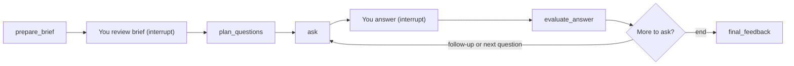

# Interview Prep Voice Agent — Plan

Source of truth: the Claude Docs version of this plan. This file is a Markdown copy for Claude Code and other surfaces (as of 2026-11-24).

## Goal and principles

A voice agent that runs realistic mock interviews from the documents I upload about a company and a role, then gives scored feedback. A local MVP first (Docker Compose), then AWS.

- **Interview types:** behavioral / HR, technical backend, system design, and tailored to a job post.
- **MVP first:** a push-to-talk web page running locally; streaming and live turn detection come later.
- **Control:** the graph pauses explicitly at every human step, prompts are versioned in files, models and providers are set in config, and each phase ends with a check I run myself.
- **Traceability:** every turn is one LangSmith trace (STT, each graph node, LLM calls, TTS).
- **Portfolio-grade:** evals, Terraform and an architecture README, so the project can be shown in interviews.

## Fast iteration loop

The goal is to change one thing and test it again within seconds, without rebuilding or speaking every time.

| To check | How | Time |
| --- | --- | --- |
| A code or prompt change | `docker compose up` once; code mounted as a volume, `uvicorn --reload`; prompts re-read from `prompts/` on each call | Seconds, no rebuild |
| The graph logic | Text mode: same graph, typed answers (toggle on the web page) | No speaking needed |
| One node, step by step | LangGraph Studio (`langgraph dev`): see the graph, step through nodes, inspect and edit the state, replay from a checkpoint | Minutes |
| A bad turn | Open its LangSmith trace, rework the prompt in the Playground, then add the turn to the eval dataset | Minutes |
| A voice issue | Replay saved audio files (`evals/audio/`) through the pipeline | No speaking needed |
| Nothing got worse | `./scripts/eval.ps1` runs the LangSmith eval suite and compares with the last run | A few minutes |

## Stack

Claude does the reasoning. The speech, voice and embedding providers each sit behind an interface, so a swap is a config change.

| Component | Choice | Status | Why |
| --- | --- | --- | --- |
| LLM, each interview turn | Claude Haiku 5.5 | Decided | Fast enough for spoken turns |
| LLM, brief and final feedback | Claude Sonnet 5.5 | Decided | Better reasoning; speed matters less |
| Speech-to-text | Deepgram (Nova-3 / Flux) | Decided | Most common pick for voice agents; streaming and end-of-speech detection; multilingual |
| Text-to-speech | ElevenLabs (Flash v2.5) | Decided | Most natural voices; French and Spanish |
| Embeddings | Voyage AI (`vector(1024)`) | Decided | Anthropic has no embedding model and recommends Voyage |
| Orchestration | LangGraph + LangChain | Decided | Explicit state graph, `interrupt()` for human steps |
| Storage | PostgreSQL + pgvector | Decided | Interview state (checkpointer), documents, vectors |
| API | FastAPI (Python) | Decided | Async, simple |
| Tracing and evals | LangSmith | Decided | Traces, datasets, evaluators |
| Local run | Docker Compose | Decided | `api` + `db` (pgvector image) |
| Cloud | AWS `eu-west-1` (Ireland): one EC2 t4g.micro running the Compose file behind Caddy (HTTPS); SSM Parameter Store, SES, GitHub's registry (GHCR) | Decided 2026-11-24 | About $11 a month on demand, fully in Terraform; it teaches the building blocks (VPC, security groups, IAM roles, EBS). ECS + RDS + ALB (~$45-60) stays a later option |
| Infrastructure as code | Terraform | Decided | State in S3 |
| Email (login codes, Phase 4.7) | "console" provider locally (the code is printed in the server logs); Amazon SES on AWS | Decided | Behind an interface like speech; SES fits the AWS stack, about $0.10 per 1,000 emails |
| Local machine | Windows, PowerShell, Docker Desktop | Given | Scripts in PowerShell |

## Architecture

```
Browser (push-to-talk page)
   │ audio                                  ▲ audio + transcript back
   ▼                                        │
Speech-to-text (Deepgram) ──text──► Interviewer graph (LangGraph + Claude) ──reply──► Text-to-speech (ElevenLabs)
                                          │ state + retrieval                    ┆ traced
Browser ──uploads──► Voyage AI ──► Postgres + pgvector                        LangSmith
```

One FastAPI service in Docker Compose runs the three steps. Postgres keeps the interview state and the document vectors, and LangSmith records every step of every turn.

## Interview context

Each practice session belongs to an **Interview**: company, role, date, interviewer names, plus the documents I attach to it.

1. **Upload:** PDF, DOCX, `.eml` emails or pasted text (recruiter email, job post, notes from a call). Each file is parsed, split into chunks, embedded with Voyage and stored in pgvector, tagged with `user_id`, `interview_id`, `doc_type` and `source`. Each user's CV is stored once and shared by all of that user's interviews.
2. **Brief, which I review:** Claude Sonnet reads all the documents and writes a structured Interview Brief (Pydantic model):
    - company summary and what the role requires
    - likely interview format, and who the interviewers are
    - gaps between my CV and the role
    - areas to focus on, and probable questions
3. **Approval:** the graph pauses with `interrupt()` so I can read, edit or approve the brief before the interview starts.
4. **During the interview:** the approved brief is always in the system prompt (short, prompt-cached). Each question also triggers a pgvector search for specific details. The retrieved chunks appear in the LangSmith trace.

**Privacy:** recruiter emails contain personal data, and LangSmith traces contain whatever is sent. Keep the MVP local, and mask inputs and outputs in LangSmith for the ingestion steps if needed. Once other people have accounts (Phase 4.6), their CVs and emails would land in my LangSmith traces too, so their inputs are hidden or they are told at registration (open question below).

## Interviewer graph



All four modes share this graph; they differ only in prompts, rubrics and question sources. Follow-ups are capped at 2 per question.

**State:** session ID, interview ID, mode, approved brief, message history, planned questions, current question index, follow-up count, scores.

## Data model

| Table | Holds | Key columns |
| --- | --- | --- |
| `users` | One account (Phase 4.6; 4.7 drops `password_hash` and adds quotas) | email (unique, lowercased), is_admin, disabled_at, `email_verified_at`, `practice_quota` (1), `interview_quota` (2) |
| `email_codes` | Login codes sent by email (Phase 4.7) | email, `code_hash` (HMAC, never the code), purpose (login / delete_account), expires_at (10 min), attempts, used_at |
| `access_requests` | "Request more" (Phase 4.7) | `user_id`, message, created_at, handled_at, granted (practices / interviews added) |
| `invites` | Invite codes (Phase 4.6; **removed in 4.7**) | `code_hash`, `email`, note, expires_at, `used_at`, `used_by` |
| `login_sessions` | Who is logged in (Phase 4.6) | `user_id`, `token_hash`, expires_at, last_seen_at; deleting the row logs out |
| `interviews` | One upcoming interview | `user_id`, company, role, date, interviewers, mode, `brief` (JSON), brief status |
| `documents` | Uploaded files and pasted texts | `user_id`, `interview_id` (null for the CV), doc_type, source, S3 key / raw text |
| `chunks` | Searchable pieces of documents | `document_id`, `user_id` and `interview_id` (copied from the document), text, `embedding vector(1024)`, metadata |
| `question_bank` | Seeded questions for technical and system design | mode, topic, difficulty, text, embedding |
| `sessions` | One practice run | `interview_id`, LangGraph `thread_id`, started / ended, `kind` (practice / interview, Phase 4.7) |
| `turns` | Each question and answer | `session_id`, question, transcript, score, LangSmith `run_id` |
| `feedback` | Final report and my rating of it | `session_id`, rubric scores, strengths, fixes, thumbs up / down |
| `usage` | Each paid API call (Phase 4.5) | provider, model, units, cost_usd, `user_id`, session_id, created_at |

LangGraph's Postgres checkpointer keeps its own tables for graph state. Sessions and checkpoints need no `user_id`: they belong to an interview, which belongs to a user.

## Accounts and access

Before the public URL, people can only use the app with an account, and they can only create one with an invite code that I give them. Everything is built in the app (no Cognito / Auth0): a few invited users don't need more, and it stays readable.

1. **Invite:** `python scripts/create_invite.py --email marie@example.com --days 14 --note "Marie"` prints a code such as `K7QM-2XPA-9RTD` once. I send it, with that email, to the person.
2. **Register:** email, password (at least 10 characters) and the code. A valid code for that email creates the account and logs the person in. A wrong, expired, used or other-email code always gets the same message.
3. **Log in:** email and password; the login lasts 30 days, or until logout.
4. **Isolation:** each user sees only their own interviews, CV, documents and sessions.

**Security choices:**

| Topic | Choice | Why |
| --- | --- | --- |
| Passwords | Argon2 hash (`argon2-cffi`) | The current recommended hash; never logged or returned |
| Staying logged in | Random token in an `HttpOnly`, `SameSite=Lax` cookie (`Secure` on AWS); only its hash is stored | The page and the API share one origin, so a cookie is simpler and safer than a token in localStorage; logout works immediately |
| Cross-site requests (CSRF) | `SameSite=Lax` plus a check that the `Origin` header of every POST / PATCH / DELETE is the app's own | Covers the file-upload forms too |
| Someone else's data | Every route takes the current user; helpers such as `owned_interview()` answer **404, not 403** | One place to get it right; IDs can't be probed |
| Guessing | 5 failed logins per email per 15 minutes; a limit on registrations per IP; counts in Postgres | Works with several containers on AWS |
| Admin | Scripts only: create invite, list users, disable user, reset password | No admin page to secure |
| Forgotten password | `reset_password.py` prints a temporary password I send to the person | No email provider needed for a few known users |
| Leaving | "Delete my account" removes interviews, documents, chunks, sessions and their LangGraph checkpoints (by `thread_id`, as they have no foreign key) | Their personal data must be removable |

**Existing data:** one migration (0006) adds the `user_id` columns as optional, gives every existing row to the oldest admin account (or the oldest account), then makes `user_id` required. With data but no account, it stops and says to create the account first (`docker compose run --rm api python scripts/create_user.py ... --admin`).

### From Phase 4.7: sign up with an email code, one practice, then interviews

Phase 4.7 replaces invite-only registration and passwords. Anyone can start, with a verified email, and quotas decide what they can use (decided 2026-11-24: no invites, code-only login, no automatic reset; one practice with the person's own documents instead of a fixed demo).

```
Email  ->  6-digit code by email  ->  logged in (account created the first time)
       ->  1 practice (own documents, short)  ->  2 interviews  ->  "Request more"  ->  I grant more
```

1. **Log in (and sign up) by code:** the person types an email; the app emails a 6-digit code; typing it back creates the account if needed and logs in (same cookie as today, 30 days). There are no passwords at all: nothing to store, leak, reuse or reset. Verifying the email matters because without it anyone could type `a1@x.com`, `a2@x.com`... and get unlimited free practices on my API keys.
2. **The practice:** 1 per account. The person sets up an interview as usual, with their own documents (job post, notes, CV), reviews the brief, and the practice is a **shorter session**: 3 questions, with voice, and short feedback written by Haiku instead of Sonnet. The brief is still written by Sonnet, since it is what makes the questions personal. About $0.25-0.30. Its first session on an account is the practice automatically (labelled "Practice" on the page); the documents and the approved brief stay, so the interviews that follow can reuse them without uploading again.
3. **Interviews:** 2 per account, the full session (5 questions by default, Sonnet feedback, about $0.50 each).
4. **Request more:** when a quota is used up, the page offers "Request more" (with an optional message). I see requests with `manage_users.py requests` and grant with `manage_users.py grant EMAIL --interviews 2`; the person gets an email. Quotas never reset by themselves.
5. **Admins** have no quota. The daily limit (4 interviews a day) and the budgets still apply to everyone.

**What goes away** (built in 4.6): passwords (Argon2, `argon2-cffi`), invite codes (`invites` table, `create_invite.py`, `/auth/register`, the registration form), change password and `reset-password`. **What stays:** the login cookie, per-user data and the 404 ownership checks, the Origin check, the admin script, "Delete my account" (now confirmed with a fresh emailed code instead of the password), and the guessing limits (now on codes).

**Security choices:**

| Topic | Choice | Why |
| --- | --- | --- |
| The code | 6 random digits, valid 10 minutes, at most 5 tries, one use; a new code replaces the previous one | 5 guesses out of 1,000,000 per code |
| Storing it | HMAC-SHA-256 with a server secret (`SECRET_KEY` in `.env`), never the code | A plain hash of 6 digits could be reversed in a second by trying them all; with the secret, a leaked table is useless |
| Asking for codes | At most 3 codes per email per 15 minutes and 10 per IP address; counts in `auth_attempts` | Stops flooding someone's inbox and spending on email |
| The answer to "send me a code" | Always "check your inbox", even for a disabled account (which gets no email) | Says nothing about who has an account |
| Bots (public URL, Phase 5) | Cloudflare Turnstile, a free check, before a code is sent | Scripts can't create accounts in bulk |
| Disposable inboxes | Not blocked at first; the trial budget caps what they can cost | Keep it simple until it's a real problem |
| Practices' cost | Their own budget, e.g. $3 a month and $0.75 a day (`BUDGET_PRACTICE_*`), inside the global one | New sign-ups trying the app can't use up the interviews' budget (about 10 practices a month) |
| Personal data at sign-up | Uploads happen only after the email is verified, so every document belongs to an account its owner can delete; the "where your data goes" note is on the first screen | People try it with their real CV from the first session |

## Cost control

All paid APIs together stay under **$10 a month** (AWS hosting is budgeted separately: about $11 a month, Phase 5). At about $0.50 per spoken interview, that is about 20 interviews a month.

**Estimated cost of one spoken interview** (5 questions, about 10 turns, 15 minutes of answers). Prices are approximate as of November 2026; confirm them on each provider's pricing page.

| Provider | What is billed | Price | Per interview |
| --- | --- | --- | --- |
| Claude Sonnet 5.5 | brief, question plan, final feedback | $2 in / $10 out per million tokens | ~$0.20 |
| Claude Haiku 5.5 | each question and each score (~20 calls) | $0.10 in / $0.50 out per million tokens | ~$0.01 |
| ElevenLabs Flash v2.5 | ~4,000 characters spoken | ~$0.05 per 1,000 characters | ~$0.20 |
| Deepgram Nova-3 | ~15 minutes of recorded answers | ~$0.0043 per minute | ~$0.07 |
| Voyage voyage-4 | document chunks and search queries | $0.06 per million tokens, first 200M free | ~$0 |
| **Total** | | | **~$0.48** |

**Monthly budgets.** The app warns at 80% of a budget. At 100% it refuses new sessions, but an interview already running can finish and get its feedback. Each provider also gets its own cap in its console, as a safety net if the app's count is wrong.

| Provider | App budget (USD / month) | Cap at the provider |
| --- | --- | --- |
| Claude | 4.50 | workspace spend limit of $6 in the Claude Console |
| ElevenLabs | 4.00 | a plan with usage-based billing off, so it stops at its quota |
| Deepgram | 1.00 | prepaid credit only, no auto-recharge |
| Voyage | 0.50 | free tier; a payment method only to lift the 3 requests / minute limit |
| **All, per month** | **10.00** | |
| **All, per day** | **1.50** | stops a runaway day from using the month |

**Limits per session and per input**, so one session or one large file can't use up the budget:

| Limit | Value | Why |
| --- | --- | --- |
| Interviews started per day | 4 | backs up the daily budget |
| Brief revisions per session | 3 | each one is a Sonnet call at high effort (~$0.08) |
| Questions per session | 5 by default, 8 at most | each question adds Haiku calls, speech and feedback length |
| Follow-ups per question | 2 (3 for system design) | already in place |
| Recording length per answer | 3 minutes | Deepgram bills per second; the page stops recording at the limit |
| Spoken question length | 600 characters | ElevenLabs bills per character; longer questions are shown as text only |
| Question replays | free | each question's audio is saved, so a replay isn't billed again |
| Documents per interview | 10 files, 200,000 characters in total | they are all sent to Sonnet for the brief, and embedded |
| Web page imports | 3 per interview, 50,000 characters each | same reason |
| Eval run (Phase 4) | $1 per run, counted in the monthly budget | a full eval run calls Claude many times |

**Several users:** invited users spend on my API keys, so the limits above apply per user (each user has their own daily limits), while the monthly and daily budgets stay global caps for everyone together.

**The practice (Phase 4.7)** has its own budget inside the global one (about $3 a month, $0.75 a day). It is shorter than an interview (3 questions) and uses Haiku for its feedback, so it costs about $0.25-0.30, most of it the Sonnet brief and the voice.

**How it is enforced:** a `usage` table records every paid call: provider, model, units (tokens, audio seconds, characters), cost in dollars and the user. Prices are kept in `pricing.yaml`, so a price change is a one-line edit. A guard checks the budgets before each session starts and before each paid call. The web page shows the month's spend. Every limit is set in `.env` (e.g. `BUDGET_MONTHLY_USD`). LangSmith's cost per trace is a cross-check for Claude.

## Phases

The MVP is done at the end of Phase 2. Each phase ends with a check I run myself before moving on.

### Phase 0: Skeleton (about half a day)
- [x] Repo, `docker-compose.yml` with `api` and `db` (pgvector image), `.env.example`
- [x] FastAPI `/health`, Alembic migrations, pgvector extension enabled
- [ ] API keys: Anthropic, Deepgram, ElevenLabs, Voyage, LangSmith

**Check:** `docker compose up` works and a test Claude call shows up in LangSmith.

### Phase 1: Text interview with the brief
- [x] Graph: `prepare_brief` → review → `plan_questions` → `ask` → answer → `evaluate_answer` → `final_feedback`
- [x] Pasted text only; all documents go straight into Claude's context, no embeddings yet
- [x] Postgres checkpointer, so a session can be stopped and resumed
- [x] Prompts in `prompts/`, rubric in `rubrics/`

**Check:** I approve a brief, then do a typed 5-question interview based on it and get final feedback.

### Phase 2: Voice (MVP)
- [x] Speech-to-text and text-to-speech interfaces, plus Deepgram and ElevenLabs implementations
- [x] One-page web UI: record button, transcript, audio playback (works on `localhost` without HTTPS)
- [x] `POST /sessions/{id}/turn` takes audio and returns audio and the transcript
- [x] Interview language per interview: English, French or Spanish (interviewer, voice, brief and feedback)

**Check:** a full spoken interview runs locally, at under about 3 s per turn.

### Phase 3: Uploads, pgvector and all modes
- [x] PDF, DOCX and `.eml` parsing, chunking, Voyage embeddings (`voyage-4`)
- [x] Per-question retrieval from pgvector (traced as retriever runs; the transcript records each question's sources)
- [x] Seed the question bank; add the technical backend and system design modes

**Check:** the LangSmith trace shows which document each question came from.

### Phase 4: Evals
- [x] Offline dataset: 36 answers (30 fictional + 6 from real sessions, git-ignored), each with an expected score range and follow-up decision ([evals/answer_scoring/](evals/answer_scoring/))
- [ ] LLM-as-judge evaluators: scoring accuracy, question relevance to the documents, sensible follow-ups, brief grounded in the documents
- [ ] Coded checks: no repeated questions, the agent stays in role, turn latency budget
- [x] `./scripts/eval.ps1` compares every prompt change with the previous run (LangSmith experiment + local summary)
- [ ] Thumbs up / down on feedback attached to the trace

**Check:** an eval run report in LangSmith that I can compare across prompt versions.

### Phase 4.5: Cost control (before the public URL)

Built after Phase 4.6, so that spending and limits can be counted per user.

- [x] `usage` table (with `user_id`) and `pricing.yaml`; record the cost of every Claude, Deepgram, ElevenLabs and Voyage call
- [x] Budget guard: warn at 80%, refuse new sessions at 100% of the monthly or daily budget, let a running interview finish
- [x] Per-session and per-input limits from the Cost control section, set in `.env`, counted per user (an interview counts toward the daily limit once its questions are planned, so briefs don't use one up; a CV is capped at 50,000 characters)
- [x] Save each question's audio so replays are free
- [x] Month's spend shown on the web page (the admin sees the budget, highlighted from 80%)
- [ ] A cap set in each provider's console (Claude Console spend limit, ElevenLabs without usage-based billing, Deepgram prepaid only)

**Check:** with the monthly budget set to $0.01, a running interview still ends with feedback and a new one is refused with a clear message. The recorded cost of one real interview is within 20% of what the providers' dashboards show.

### Phase 4.6: Accounts with invite codes (before the public URL, before 4.5)

Details in [Accounts and access](#accounts-and-access). Each step ends with its own check.

- [x] **Users and login:** `users` and `login_sessions` tables, Argon2 hashing, the login cookie, `/auth/login`, `/auth/logout`, `/auth/me`, a script that creates my admin account (`scripts/create_user.py`). Also built now, so nothing breaks while routes need a login: the login screen on the web page (registration comes in step 3) and the CLI login. Check: I log in and out, and the API answers 401 without the cookie.
- [x] **Ownership:** `user_id` on interviews, documents and chunks; existing rows given to me; `current_user` and ownership helpers on every route; the CV search filtered by user. Check: a second test account gets 404 on my interview, sessions and CV, and my CV never appears in its search results.
- [x] **Invites and registration:** `invites` table, `create_invite.py`, `/auth/register`, a registration screen on the web page (same palette and fonts), reached from a "Create an account" link on the login screen. Check: a one-use code works once, then is refused with a clear message.
- [x] **Hardening:** login and registration limits, the `Origin` check, "Delete my account", the admin scripts (`scripts/manage_users.py`: list, invites, disable, enable, reset password, delete), a short privacy note at registration. Also built: change password (`POST /auth/password`), needed after a reset. Check: the 6th wrong password is blocked, and no row of a deleted user remains (checkpoints included).
- [x] Tests for each step (a logged-in client fixture for the existing tests; isolation between two users); HOW_IT_WORKS.md and README updated.

**Check:** someone I invite registers with their code, runs an interview, and can't see anything of mine; I can't see theirs through the web page either.

### Phase 4.7: Open sign-up by email code, one practice, quotas (before the public URL)

Details in [From Phase 4.7](#from-phase-47-sign-up-with-an-email-code-one-practice-then-interviews). Each step ends with its own check.

- [x] **Code login and sign-up:** an email interface with a "console" provider (code printed in the logs; the Amazon SES provider is added in Phase 5, where it can be tested with a verified domain); `email_codes` table; `POST /auth/start` (send a code) and `POST /auth/verify` (check it, create the account if needed, log in); the first screen becomes email, then code; limits on code requests and tries; "Delete my account" confirmed by a code; the CLI logs in with a code; `create_user.py` without a password. Removes passwords, invite codes, `/auth/register`, the registration form, change password and `reset-password` (a migration drops `users.password_hash` and the `invites` table). Check: a new email gets a code in the logs and lands logged in on an empty account; a wrong code 5 times is refused; an old code no longer works.
- [x] **The practice, quotas and requests:** `practice_quota` (1) / `interview_quota` (2) on users, `sessions.kind`; while a practice is left, a session is a practice (3 questions, Haiku feedback, labelled on the page); a session counts once its questions are planned, as today; the practice budget; the remaining counts in `GET /usage` and in the header ("Practice", then "2 interviews left"); "Request more" (`access_requests`), `manage_users.py requests` and `grant` (with an email to the person). Check: a new account's first session has 3 questions and Haiku feedback, costs under $0.35, and its documents are reused by the next session; the fourth session is refused with "Request more"; after `grant` it works, and the person gets the email.
- [x] Tests for each step; HOW_IT_WORKS.md, README and CLAUDE.md updated.

**Check:** a new person signs up with their email, does 1 practice and 2 interviews with their own documents, is offered "Request more", and gets more after I grant them.

### Phase 4.8: Admin login with a password, without per-user limits

Decided 2026-11-24. Everyone else keeps logging in with an emailed code; my admin account can also log in with an email and a password, so I don't depend on reading codes, and it isn't held back by per-user limits.

- [x] **Password for admins only:** `users.password_hash` (optional, migration 0012), Argon2 (`argon2-cffi`), at least 12 characters; `manage_users.py set-password EMAIL` / `clear-password EMAIL` (admins only), `create_user.py --admin` offers to set one; `POST /auth/password-login`, with the same answer for a wrong password, a non-admin email and an admin without a password, and the existing limits (5 wrong per email, 20 per IP, per 15 minutes); a small "Admin? Log in with a password" form on the login screen; the CLI uses `INTERVIEW_PASSWORD` when set. The code login stays as a fallback.
- [x] **No per-user limits for admins:** besides having no quota (already), an admin skips the interviews-per-day limit and the brief-revisions limit. The global budgets and the size limits (questions, recording, documents, CV) still apply to everyone: they protect against runaway costs and mistakes.
- [x] Tests; HOW_IT_WORKS.md, README and CLAUDE.md updated.

**Check:** I set my password, log in with it, start more than 4 interviews in a day and ask for more than 3 brief revisions; a wrong password 6 times is blocked; a non-admin can't log in with a password.

### Phase 4.9: Login and header polish

Decided 2026-11-24, after using the page.

- [x] **One email field:** "Continue" asks an admin with a password for it (`POST /auth/start` answers `method: "password"`, an accepted trade-off: it shows which emails are admins with a password), and sends a code to everyone else; "Send me a code instead" (`use_code`). The "Admin? Log in with a password" link and the "where your data goes" note are gone (the README keeps the privacy text).
- [x] **Continue with Google:** Google Identity Services button, `POST /auth/google` checks the ID token with `google-auth`, `users.google_sub` (migration 0013), links an existing account with the same email. Needs `GOOGLE_CLIENT_ID`.
- [x] **Header:** users see what's left ("Practice + 2 interviews left"), never money (`GET /usage` no longer sends their spend); the admin keeps the budget.
- [x] **"Files from the company (optional)"** label on the setup form.
- [x] **Instant return to a brief:** a brief waiting for review is stored as a draft and reused with no Claude call when only the number of questions or the length changed; files and a pasted CV are cleared from the form once sent, so they no longer look like changes.
- [x] **Logo:** `web/brand/` (header logo for light and dark, app icon as favicon and on the login card); a click on it starts a new interview.
- [x] Tests; HOW_IT_WORKS.md, README and CLAUDE.md updated.

**Check:** I log in as admin and get the password field; a new email gets a code; Continue with Google signs up a new account; the header shows what's left; going back from a brief with nothing changed is instant; the logo works in light and dark and leads back to a new interview.

### Phase 5: AWS with Terraform (one EC2 server)

Decided 2026-11-24: **EC2 t4g.micro in `eu-west-1` (Ireland)**, everything in Terraform, chosen for learning (VPC, subnets, security groups, IAM roles, EBS, AMIs, user data, Session Manager are the building blocks under ECS and most AWS work) and cost. The server runs the same Compose file as my laptop: the app, Postgres and Caddy (automatic HTTPS from Let's Encrypt).

**Cost** (AWS Pricing API, November 2026, on demand): server $6.72 ($0.0092 / hour), 10 GB gp3 disk $0.88, public IPv4 (Elastic IP) $3.65, weekly snapshots and DNS about $1-1.50: **about $11-12 a month**. To stay at or below $10: stop the server when I'm not using it while I learn (only the disk and IP are billed, about $5), and take a 1-year Compute Savings Plan (about 35% off the server) once it serves real users. Ireland costs the same as Spain (`eu-south-2`, an opt-in region) and is the most complete EU region. An AWS Budget emails me at $10. The API budgets of Phase 4.5 stay as they are.

**Risk:** 1 GB of memory shared by the app, Postgres and Caddy. Step 1 measures it; a 2 GB swap file is the safety margin; if it doesn't fit, t4g.small (2 GB) brings the total to about $19 a month.

- [x] **Step 1, the app in production mode (no AWS cost):** `docker-compose.prod.yml` (the app from its image, no source mount, no `--reload`; Postgres not reachable from outside; Caddy the only thing on ports 80 / 443); `COOKIE_SECURE=true`; uvicorn `--proxy-headers` trusting only Caddy, so the guessing limits see each visitor's IP; the server refuses to start without `SECRET_KEY` in production; the Amazon SES provider in `app/mail` (`boto3`, credentials from the server's IAM role, no keys); Cloudflare Turnstile on "Send me a code" (off locally); memory measured with `docker stats` and capped (Postgres tuned small). Personal files already left out of the image (`.dockerignore`). Check: tests pass; the production Compose file runs on my laptop. **Done 2026-11-25:** 88 tests pass; on the laptop, HTTPS through Caddy, the start refused with unsafe settings, Turnstile with the test keys (also in a browser), SES really called (refused for lack of credentials), the visitor IP seen through Caddy and a faked X-Forwarded-For ignored; memory about 260 MB at rest and 280 MB under a burst (caps: caddy 64 MB, api 512 MB, db 256 MB).
- [ ] **Step 2, Terraform** (written 2026-11-25: `terraform validate` passes, a plan of 20 resources, the boot scripts' syntax checked; `deploy.sh` on the server builds `.env` from SSM and is what step 4 runs; applied the same day: the server `i-0bfdc5b260920a188` booted with Docker, Compose v5.6.1, swap and automatic updates in about 7 minutes, and answers SSM Run Command; 236 MB of 910 MB used before the app. Left for the check: the secrets (`set-secrets.ps1`) and the image in GHCR, then `deploy.sh` and `/health`)**:** `infra/bootstrap` (the S3 bucket for Terraform's state: versioned, encrypted, private, with S3 locking); `infra/` (a VPC with one public subnet and an internet gateway; a security group open only on 80 and 443, **no SSH**; an IAM role for the server: Session Manager, send email with SES, read its own SSM parameters; EC2 t4g.micro on Amazon Linux 2023 arm64, IMDSv2 required with a hop limit of 2 (so the api container, one network hop further than the server, can read the IAM role's credentials for SES), encrypted 10 GB gp3 disk, an Elastic IP; user data that installs Docker, a swap file and automatic security updates, then starts the Compose file; weekly snapshots kept 4 weeks (Data Lifecycle Manager); SSM parameters for the API keys and `SECRET_KEY`, whose values I type with the AWS CLI so they never sit in Terraform's state; the AWS Budget). Check: `terraform apply`, then `/health` answers through the Elastic IP; a shell opens with Session Manager.
- [ ] **Step 3, domain, HTTPS and email:** a DNS record for the Elastic IP, Caddy's certificate, `COOKIE_SECURE=true` live; SES domain identity with DKIM records, then the request to leave the SES sandbox; Turnstile keys for the domain. Check: the page loads over HTTPS and a login code arrives in a real inbox.
- [ ] **Step 4, deploys from GitHub Actions:** build the `arm64` image on GitHub's ARM runner, push it to GHCR, then update the server through SSM Run Command; GitHub logs in to AWS with **OIDC** (short-lived credentials, a role allowed only to deploy), so no AWS keys are stored in the public repo. Check: a push to `main` is live a few minutes later.
- [ ] **Step 5, run it:** restore a snapshot once on a test server; document start / stop / restore / costs in HOW_IT_WORKS.md.

**Check:** a voice interview works on the public HTTPS URL (the mic requires HTTPS outside localhost), a new person signs up with a real emailed code, and the month's AWS bill stays around $11.

**Later options:** ECS Fargate + RDS + ALB (managed database and containers, about $45-60 a month); CloudWatch logs and alarms.

### Phase 6: Improvements (order to decide)
- [ ] Streaming over WebSocket, sentence-by-sentence text-to-speech
- [ ] Live turn detection and interrupting the agent mid-sentence
- [ ] Session history and progress view
- [ ] Interviewer personas
- [x] Load a company web page from a URL into the documents
- [ ] Benchmark other speech providers through the interfaces

## Repo layout

```
app/
  api/          # FastAPI routes
  auth/         # login codes, login cookie, current_user, /auth routes (Phase 4.6, 4.7)
  mail/         # email interface: console (local), Amazon SES (AWS) (Phase 4.7)
  graph/        # state.py, nodes.py, build.py
  voice/        # stt.py, tts.py (interfaces + Deepgram / ElevenLabs implementations)
  rag/          # parsers, ingest.py, retrieve.py
  db/           # models, alembic migrations
prompts/        # one file per mode and node
rubrics/        # YAML scoring rubrics
evals/          # datasets + evaluators
web/            # index.html + app.js
infra/          # Terraform (Phase 5): bootstrap/ (state bucket), then the network, server, IAM, DNS, SES, budget
scripts/        # PowerShell helpers
docker-compose.yml
.env.example
```

## Speech provider options

The proposal is Deepgram + ElevenLabs. No public per-vendor usage figures exist, so the ranking is an estimate from 2026 comparisons.

| # | Speech-to-text | Streaming | Best for |
| --- | --- | --- | --- |
| 1 | OpenAI Whisper (API or self-hosted) | API: no | Most used overall (open source) |
| 2 | Deepgram (Nova-3 / Flux) | Yes | Voice agents |
| 3 | AssemblyAI | Yes | Accuracy, transcript analysis |
| 4 | Google Cloud Speech | Yes | Google Cloud users |
| 5 | AWS Transcribe | Yes | Keeping everything in AWS |
| 6 | Azure Speech | Yes | Microsoft users |
| 7 | ElevenLabs Scribe | Yes | Multilingual real-time |

| # | Text-to-speech | Best for |
| --- | --- | --- |
| 1 | ElevenLabs | Most natural voices, many languages |
| 2 | OpenAI TTS | Simplest API (check deprecation dates before choosing) |
| 3 | Google Cloud TTS | Google Cloud users |
| 4 | Amazon Polly | Keeping everything in AWS, cheap |
| 5 | Azure Speech | Microsoft users |
| 6 | Cartesia Sonic | Lowest latency for voice agents |
| 7 | Deepgram Aura-2 | Low price, same vendor as Deepgram STT |
| 8 | Piper, Kokoro (local) | Free, in Docker; less natural |

## Open questions

- [x] Confirm speech providers for the MVP: **Deepgram + ElevenLabs** (decided 2026-11-19)
- [x] Does Claude write the code for each phase, or guide me while I write it? **Claude writes it**, explained for beginners (file headers + HOW_IT_WORKS.md)
- [x] Interview languages: **English, French and Spanish from the MVP** (decided 2026-11-19)
- [x] Which languages should the feedback report be in? **The interview's language** (default chosen with the language decision; easy to change in `prompts/final_feedback.md`)
- [x] Invite codes: one code per person or a shared code? **One code per person** (decided 2026-11-23)
- [x] Should a code only work for the email I made it for? **Yes, each code is locked to one email** (decided 2026-11-23)
- [ ] Other users' data in my LangSmith traces: hide their inputs and outputs, or tell them at registration? (The registration form now tells them; hiding is still possible later.)
- [x] Open access: **sign up with an email code**, 1 practice with their own documents (shorter session), then 2 interviews, then "Request more"; no invite codes, no passwords, no automatic reset (decided 2026-11-24)
- [ ] ElevenLabs plan: the free tier (about 5 interviews a month) or a paid plan? A subscription would use a large share of the $10 budget.
